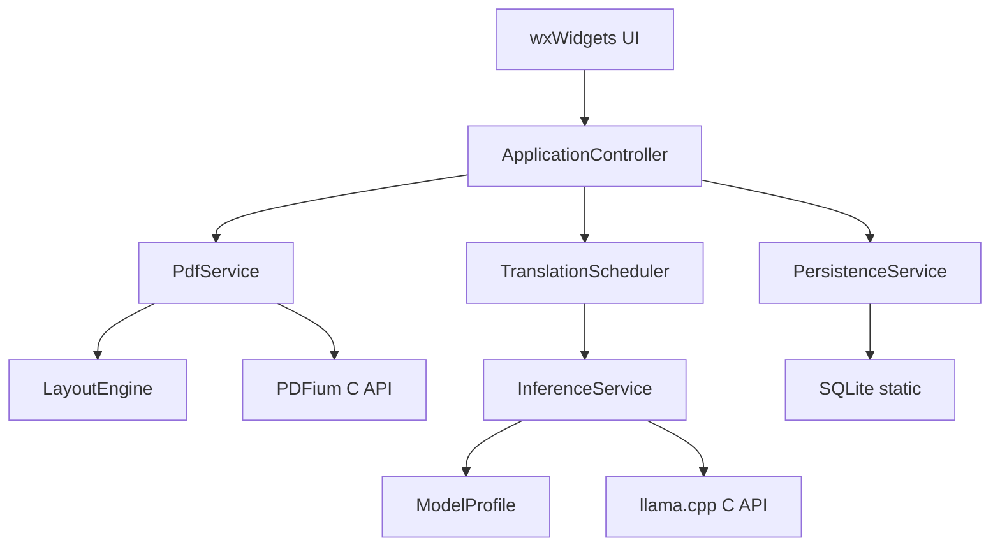

# Offline PDF Translator — 新規実装設計書

版: 1.0 / 作成日: 2026-11-09 / 対象: 新しいリポジトリから実装するデスクトップアプリ

## 0. 実装AIへの指示

この文書を、新規アプリの製品仕様・内部設計・実装順序・受入条件として使う。仮の製品名は **Offline PDF Translator**、実行ファイル名は `offline-pdf-translator.exe`、Macのアプリ名は `Offline PDF Translator.app` とする。名称は一箇所の製品定義から変更できるようにする。

**C++20＋wxWidgets＋PDFium＋llama.cppで、新しいリポジトリへ一から実装する。** 既存アプリのリポジトリ、コード、ディレクトリ構成、設定、プロンプト、修正パッチ、画像、フォント、テストデータ、キャッシュ形式は引き継がない。新規に取得する各ライブラリの公式配布物と、新規に作成するコード・素材を使用する。

画面の基本構成は「左にPDFの原文、右に同じページの訳文」とする。WebViewの動作、DOM、HTML、CSS、既存の画面部品を再現する必要はない。ネイティブの読書アプリとして実装する。

実装は第25章のM0から順に進める。最初に両OSで静的リンクと最小動作を成立させ、その後に画面・抽出・翻訳を積み上げる。各工程で動く成果物を残す。外部DLLやランタイムのインストールを追加して、配布要件を解決したことにしない。

本書で値を指定したキャッシュ量、バッチ量、表示間隔は実装の初期値である。実測に基づいて調整してよい。利用者のPC、PDF、GGUFを拒否する新たな条件にはしない。依存バージョン、SDK、最低対応OSの実測値はM0で確定し、再現可能なlockと試験記録へ残す。未実施のWindows／Mac試験を実施済みと報告しない。

### 文書の読み方

| 範囲 | 内容 |
|---|---|
| 第1〜4章 | 配布契約、製品範囲、確定する技術判断 |
| 第5〜8章 | 画面、操作、状態、入力とフォーカス |
| 第9〜12章 | モジュール、データ型、スレッド、キュー |
| 第13〜16章 | PDF入力、描画、座標、抽出、検索 |
| 第17〜19章 | GGUF、PLaMo、推論、翻訳キュー、キャッシュ |
| 第20〜24章 | 設定、リソース、ビルド、配布、エラー |
| 第25〜28章 | 実装手順、試験、納品物、判断記録 |
| 第29章 | 参照した公式資料 |

---

## 1. このアプリが実現すること

利用者は、アプリとローカルのGGUFを用意しておけば、ネットワークのない場所でもPDFを開き、原文を読みながら日本語訳を確認できる。モデルの読込や翻訳の進行中も、PDFのページ移動・拡大・文字選択・コピーを続けられる。

初版の主対象は、横書きの英文テキストを含むPDF、特に論文・技術文書である。初期モデルは **PLaMo 3 Translate 0.8BのGGUF、基準となる量子化はQ4_K_M**。初版の翻訳方向は英語→日本語、文体は常体／敬体とする。将来のモデル追加は `ModelProfile` の追加で行う。任意のGGUFが無条件に翻訳モデルとして動くという製品仕様にはしない。

PDFの原本は変更しない。右側へ表示するのは、そのページから抽出したテキストの翻訳である。図、式、表を含む元の紙面は左側で読む。翻訳結果を元PDFへ再配置して新しいPDFを作る機能は初版に含めない。

## 2. 配布とオフライン動作の契約

### 2.1 必須要件

| ID | 要件 | 合格の意味 |
|---|---|---|
| R01 | Windowsは単一EXE | EXEだけを別フォルダへ移して起動できる。アプリ固有DLLやsidecarを要求しない |
| R02 | Macは自己完結した `.app` | `.app` の外にアプリ用ライブラリ・データを要求しない |
| R03 | 追加ランタイムの導入不要 | VC++ Redistributable、WebView2、Python、Node.js、.NET、Java、Homebrew、Xcodeを利用者へ要求しない |
| R04 | 初回からオフライン | 設定・キャッシュがない状態でも、ネットを切ってPDF表示と翻訳が成立する |
| R05 | 外部の必須入力はPDFとGGUF | tokenizer、prompt、ICUデータ、フォント、Metal用データ等を利用時に別途取得しない |
| R06 | CPUで動く経路を持つ | WindowsはCPUを標準とする。MacはMetalが使えなくてもCPUで動く |
| R07 | UIを処理待ちにしない | PDF処理、モデル読込、推論、大きなI/OをGUIスレッドで実行しない |
| R08 | ページと訳文を取り違えない | 文書、ページ、モデル、原文、設定の変更後に古い結果を混ぜない |
| R09 | 不完全な翻訳を完成扱いしない | 停止、上限到達、生成失敗を正常完了・正常キャッシュと区別する |
| R10 | 新規アプリとして独立 | 旧アプリの資産や状態を自動移行しない |

### 2.2 「アプリ内で完結」の定義

Windows／macOS自身が提供するDLL・framework・システムライブラリは利用してよい。OSまで静的リンクするという意味ではない。WindowsのOS標準DLLや、MacのAppKit、CoreGraphics、Metal、libSystem等はこの範囲に含める。

Windowsでは、PDFium、wxWidgets、llama.cpp、その実行に必要な非OSライブラリを静的にリンクする。フォント、文言、アイコン、ライセンス等のデータもEXEへ埋め込む。実行時にDLLを一時フォルダへ展開して読み込む方式は、この設計の基本構成に採用しない。

Macでは単一のMach-Oファイルだけに全てを押し込む必要はない。ユーザーが一つのアプリとして扱える `.app` の内部へリソースを置いてよい。自前ライブラリは原則として静的リンクし、OS frameworkは通常どおり参照する。

設定、翻訳キャッシュ、ユーザーが修正した翻訳用原文、ログは、初回起動後に通常のユーザーデータ領域へ生成してよい。これらは**配布時に必要な外部ファイルではない**。保存先が書き込めなくても、メモリ内だけで閲覧・翻訳を続けられる。アプリやモデルの存在確認のためにネット接続を要求しない。

### 2.3 対象プラットフォーム

| 成果物 | 構成 |
|---|---|
| Windows x86_64 | CPU、portableな命令セット設定、静的Release CRT |
| macOS arm64 | Native arm64、Metal優先＋CPU fallback |
| macOS x86_64 | Native x86_64、CPU必須、Metalは対応実機で確認できた場合に有効 |

初版のMac成果物はarm64版とx86_64版を別々に配布してよい。Universal化は、それぞれの動作を確認した後に行う。Apple Silicon機でRosettaの追加取得を前提にしない。

Windows 10／11を想定して開始し、M0で実際に使うSDK・依存が対応する範囲を確認する。Macのdeployment targetもM0で依存全体を揃えて確定する。最低OSの値はビルド・実機試験・READMEの三者で一致させる。未確認の古いOSへ対応すると表示しない一方、理由なく最新OSだけへ限定しない。

## 3. 初版の機能範囲

### 3.1 実装する機能

| 分類 | 機能 |
|---|---|
| PDF | ファイルを開く、ドラッグ＆ドロップ、単一ページ表示、前後移動、ページ番号指定 |
| 読書 | 幅に合わせる、ページ全体、倍率指定、表示回転、原文の選択・コピー・文書内検索 |
| 翻訳 | 現在ページの自動翻訳、明示的な現在ページ翻訳／再翻訳、全ページ翻訳、停止、再試行 |
| 訳文 | 逐次表示、選択・コピー、ページ単位の表示、文字サイズ変更 |
| 抽出の救済 | ページごとの翻訳用原文の確認・編集・保存・再翻訳 |
| モデル | ローカルGGUF選択、非同期ロード、対応profile検査、MacのCPU選択 |
| 保存 | 設定、読書位置、編集した原文、完了翻訳キャッシュ、訳文のUTF-8テキスト書出し |
| 基本品質 | 日本語UI、HiDPI、フォーカスを壊さないキーボード操作、オフライン起動 |

### 3.2 初版に含めない機能

OCR、スキャン画像からの自動文字認識、翻訳PDFの生成、PDF編集、注釈編集、XFA／JavaScript実行、LLMチャット、オンライン翻訳、モデルの自動ダウンロード、自動更新、ブラウザ表示、プラグイン、複数文書タブ、連続ページ表示、Windows GPU推論は初版の完成条件に含めない。

画像のみのPDFも画像として表示する。翻訳用原文を手入力すれば、その文章を翻訳できる。将来の機能を表す無効ボタンや空メニューは置かない。

## 4. 採用構成と設計判断

| 項目 | 決定 | 理由 |
|---|---|---|
| アプリ言語 | C++20 | 選択したライブラリを直接組み込み、所有権をRAIIで扱う |
| GUI | wxWidgetsのネイティブ部品 | Windows／Macでソースを共有し、WebView runtimeを持たない |
| PDF | PDFiumの公開C API | 描画・文字・座標情報を同一エンジンから得る |
| 推論 | llama.cppの公開C API | モデルとcontextをアプリ内で保持し、別サーバーの起動管理を不要にする |
| PDFの表示形式 | ラスタタイル＋文字の幾何情報 | 紙面の再現と選択・検索を分離し、巨大bitmapを避ける |
| 訳文 | ネイティブのプレーンテキスト欄 | 読書、選択、コピーを標準の挙動で提供する |
| 状態とキャッシュ | SQLite amalgamationを静的リンク | 編集した原文と完了翻訳をtransactionで保存する。DBサーバーは不要 |
| 文字列 | コアはUTF-8、境界でOS／wx形式へ変換 | パス・文字index・画面位置の混同を防ぐ |
| 画面と処理 | メッセージで接続 | GUI、PDFium、llama、保存処理の所有権を分ける |
| 初期GPU | Mac Metalのみ | OSが提供する機能で構成できる。WindowsはCPU配布を先に完成させる |

SQLiteは小さな組み込み部品として追加する。CLI、共有ライブラリ、サービスを製品に同梱しない。公式の `sqlite3.c`／`sqlite3.h` をアプリと同じtoolchain・CRTでコンパイルする。[S12]

直接C APIを使うことだけで推論速度が大幅に上がるとは仮定しない。この構成の主な効果は、モデルの再ロード、プロセス間の形式変換、サーバーの準備、ポート管理を不要にし、状態・停止・配布を一つのアプリで扱えることである。速度は実モデルと実機で計測する。

---

## 5. メイン画面

### 5.1 部品構成

| 領域 | 部品と内容 |
|---|---|
| メイン | `wxFrame`。タイトルは「ファイル名 — Offline PDF Translator」 |
| メニュー | OS標準のファイル／編集／表示／翻訳／ヘルプ |
| 操作バー | `wxPanel`とsizer。PDFを開く、前後ページ、ページ番号、ズーム、翻訳、停止、モデル設定 |
| 中央 | `wxSplitterWindow`で左：原文、右：訳文 |
| 左 | 短い見出し、`PdfCanvas`、必要時のみ検索バー |
| 右 | ページ・翻訳状態の見出し、`wxTextCtrl`、必要時のみ再試行等の操作 |
| 最下部 | `wxStatusBar`。ページ状態、モデル／backend、全ページ処理の進行 |

初回ウィンドウサイズは1280×860 DIPを目安とし、現在の作業領域へ収める。前回のサイズ・位置・最大化状態・分割比率を復元する。画面外に記録されていた場合は現在のモニター内へ戻す。左右は初回50:50。区切りのドラッグで変更でき、メニューの「左右を均等にする」で戻せる。

操作バーは狭い幅では二段にする。主要なボタンには文字ラベルを付け、操作を横に切り捨てない。ペイン間の区切りと4〜8 DIP程度の余白で整理する。カード状のパネル、装飾的な大余白、大きな角丸は使用しない。

### 5.2 左右の関係

左右は常に同じ物理ページ番号を表示する。縦スクロール、PDF倍率、訳文字サイズは独立する。訳文の長さは原文と一致しないため、スクロール比率による強制同期は実装しない。

初めて訪れるページは両側の先頭を表示し、再訪時はそれぞれの読書位置を復元する。検索結果への移動では検索位置を優先する。ページ変更後、新しい画像がまだできていなければ読込表示を出す。前ページの画像と新ページの訳文を組み合わせない。

### 5.3 メニュー

| メニュー | 項目 |
|---|---|
| ファイル | PDFを開く、最近開いたPDF、現在ページの訳文を書き出す、完了した訳文をまとめて書き出す、文書を閉じる、終了 |
| 編集 | コピー、全選択、PDF内を検索、ページの原文をコピー、翻訳用原文を確認・編集 |
| 表示 | 幅に合わせる、ページ全体、倍率、右回転、左回転、訳文の文字サイズ、左右を均等にする |
| 翻訳 | このページを翻訳、このページを最初から再翻訳、全ページを翻訳、停止、自動翻訳、文体、モデル設定 |
| ヘルプ | 操作方法、診断情報をコピー、ライセンス、このアプリについて |

「操作方法」と「ライセンス」はアプリに内蔵したテキストをネイティブダイアログで表示する。ヘルプを開くためにネット接続しない。

## 6. 画面状態とコマンド

状態は文書、モデル、翻訳を別々に保持する。全組合せを一つの巨大enumへ詰め込まない。

```cpp
enum class DocumentState { Empty, Opening, Ready, Failed };
enum class ModelState { Unconfigured, Selected, Loading, Ready, Failed };
enum class PageState {
    NotStarted, WaitingForText, Queued, Running,
    Complete, Partial, Failed, NoText
};
```

| 場面 | 表示・操作 |
|---|---|
| 起動直後 | ウィンドウを先に出す。左にPDFを開く操作。強制的な初期設定ウィザードは出さない |
| PDF読込中 | ファイル名と読込状態を表示。最初の描画を全ページ抽出の完了待ちにしない |
| モデル未設定 | PDFを読める。右側にGGUF選択操作。翻訳要求からモデル選択へ進める |
| モデル読込中 | PDFの表示・選択・ページ移動を維持。取得できない進捗率を捏造しない |
| 翻訳中 | 逐次表示。コピー・スクロール・ページ変更を維持。完了ダイアログや通知音は出さない |
| 中断 | 途中までの文章を残し「中断」と表示。完成済み部分は再利用できる |
| 文字なし | 原文は表示。「翻訳するテキストがありません」と原文編集操作を示す |
| ページ単位の失敗 | そのページの理由と再試行を示す。他ページの成果を消さない |
| モデル失敗 | 文書は閉じない。理由、別GGUF選択、MacならCPUで再試行を示す |

`CommandRouter` へ `CanExecute(command, state)` と `Execute(command)` を集約する。メニュー、ツールバー、ショートカットは同じコマンドを呼ぶ。

### 6.1 自動翻訳

初期値はON。モデルが利用可能になったら、最新の現在ページを対象にする。ページ移動は150ms程度の短いdebounceで最新の要求へまとめ、連続移動中のページを全て翻訳し始めない。モデルロード完了時に古いページへ戻さない。

停止を押したら、現在の翻訳と全ページ処理を停止し、そのページ・原文revisionについて自動翻訳を抑制する。停止直後に自動翻訳が勝手に再開してはならない。明示的な翻訳要求、別ページへの移動、または自動翻訳のOFF→ONで抑制を解除する。

### 6.2 全ページ翻訳

メニュー／ボタンから明示的に開始する。単一の推論キューを使い、別のモデルやcontextをページごとに作らない。現在ページを優先し、その後に未完了ページを物理ページ順で処理する。全ページ分の文字列やjobを一度にメモリへ積まない。

現在ページへ移動したら、そのページの未完了作業を優先する。全ページ走査のcursorは保持し、優先作業の後に再開する。停止でcursorの自動再開を止める。再度「全ページ」を実行すれば、同じ翻訳条件の完了cacheを使って未完了分を処理する。

全ページ処理は `BatchRunId` とモデル・文体等の条件snapshotを持つ。同じsource／profileの待機jobが既にあれば、その優先度を上げ、新しい同内容jobを二重投入しない。モデル・文体を変えた場合は旧条件の全ページrunを止め、現在ページの自動翻訳を新条件で始める。異なる条件の完了件数を合算しない。

状態は「完了ページ数／総ページ数、文字なし件数、部分結果件数、失敗件数」を区別する。Complete、NoText、Partial、Failedを当該runの確定状態とし、Partialや文字のないページを同じrunで繰り返し再試行しない。PartialとFailedは成功件数へ含めない。新たな全ページ実行または明示的な再試行では未完了部分を再び処理できる。

## 7. 読書操作・本文表示・原文の編集

### 7.1 ページとズーム

内部ページindexは0始まり、表示は1始まり。ページ番号欄はEnterまたは編集確定時に移動し、数字を一桁打つたびに移動しない。入力途中の空欄を許容する。不正値は前回の値へ戻し、短いフィードバックを出す。

ズームは「幅に合わせる」「ページ全体」「倍率指定」。初期値は幅に合わせる。100%は96 DIP／72 PDF pointを基準とする。倍率プリセットは50、75、100、125、150、200、400%。任意倍率入力も可能にし、極端な倍率はタイル化で扱う。倍率の範囲を、PDFの内容を拒否する条件として使わない。

マウスでのズームはポインタ下の文書点を、ボタンでは表示中心の文書点を維持する。幅合わせはペイン幅の変更で再計算する。倍率指定はペインの変更で倍率を変えない。表示回転は90度単位。PDFファイル自体の回転情報は書き換えない。

左ドラッグで文字選択、Space＋ドラッグまたは中ボタンでパン、ホイールで縦スクロール、Shift＋ホイールで横スクロール。ページ端でホイールを回しても勝手に次ページへ進まない。

### 7.2 訳文のネイティブ表示

`wxTextCtrl` を `wxTE_MULTILINE | wxTE_READONLY` で使用し、Windowsでは `wxTE_RICH2` を加える。本文はプレーンテキストとして扱う。現在ページだけを表示し、文書全体を一つの巨大なコントロールに入れない。

生成差分は50msを目安にまとめて反映する。tokenごとにイベントを作ったり、本文全体へ `SetValue()` したりしない。完成したUTF-8だけを渡し、完了イベントでは残りを反映する。

末尾を表示中で選択していないときだけ、自動で生成末尾へ追従してよい。上へスクロールまたは文字選択を始めたら追従を解除する。生成で選択や読書位置を破壊しない。「生成中の末尾へ」は必要時だけ表示する。

`TextViewportAdapter` に保存・復元を集約する。WindowsとMacのネイティブ実装が必要なら、ここだけをOS別にする。共通wx APIで位置保持できない場合、選択中は表示更新を一時的に保留し、内部結果だけ更新する方式も使える。保留中の差分は無制限に複製せず、最新の結果bufferと適用済みoffsetを保持する。

`wxTextCtrl` の位置値はUTF-8 byte offsetでも `GetValue()` の文字列添字でもない。選択範囲は同じコントロールのAPIへ返し、選択テキストは `GetStringSelection()`／`GetRange()` で得る。[S3]

永続的な読書位置の単位は、改行をLFに揃えた本文上のUnicode scalar offsetとする。`TextViewportAdapter` は任意の有効な文字境界についてnative位置との往復変換を提供する。改行、補助平面文字、日本語を含め試験する。差分の両端のcontrol位置だけを記録して、途中の位置も単純なbyte加算で変換できると仮定しない。生成中の選択復元には同じcontrolから取得したnative位置を使い、永続化・再構築の際に論理anchorへ変換する。

### 7.3 翻訳用原文の確認・編集

ページ単位のネイティブダイアログを用意する。初期内容は保存済みoverride、なければ翻訳に渡す抽出文章。ボタンは「自動抽出へ戻す」「キャンセル」「保存」「保存して再翻訳」。

「自動抽出へ戻す」は編集中のbufferと編集modeだけを戻し、保存までは確定しない。その状態で保存した場合はoverrideを解除し、source revisionを更新する。自動抽出の文章をコピーしたoverrideを残して「編集済み」としない。「保存」はモデルがなくても可能。「保存して再翻訳」は保存要求を確定してから該当ページの新revisionを翻訳する。保存完了の応答までは「保存中」とし、保存先へ書けなければ「このセッションのみ保持」と示して翻訳は継続できる。

空文字の保存も許容する。空の原文に対するLLM呼出しは行わない。overrideのあるページには「翻訳用原文を編集済み」と表示する。

編集で変わるのは翻訳入力だけ。左のPDF、PDFからのコピー、PDF内検索は変えない。編集後の文章に元の文字座標との正確な対応があると装わない。overrideのblockはページ単位の出所を持ち、細かな原文ハイライトの対応は作らない。

### 7.4 訳文の書出し

現在ページ、または完了したページをまとめてUTF-8 `.txt` へ保存する。OS標準の保存ダイアログを使う。ページ区切りに物理ページ番号を付け、文体・モデル名を先頭の短い情報欄に記録する。

初期の「完了した訳文を書き出す」は完了結果だけを対象にする。未完了ページは「未完了」と明示し、途中出力を完成した文章として混ぜない。現在ページの途中出力を含めたい場合は書出しダイアログの明示的な選択にし、ファイル内にも「途中結果」と記載する。書出しを押しただけで全ページ翻訳を開始しない。

## 8. キーボード・フォーカス・見た目

`Primary` はWindowsではCtrl、MacではCommandを指す。

| 操作 | ショートカット |
|---|---|
| PDFを開く | Primary＋O |
| ページ番号へ | Primary＋G |
| 検索 | Primary＋F |
| コピー／全選択 | Primary＋C／A |
| 現在ページを翻訳 | Primary＋Enter |
| 全ページを翻訳 | Primary＋Shift＋Enter |
| モデル設定 | Primary＋, |
| 原文・訳文・操作バーのフォーカス移動 | F6／Shift＋F6 |
| 前後ページ | Windows: Alt＋PageUp／PageDown、Mac: Command＋[／] |

裸の矢印、Home、End、PageUp、PageDownはフレーム全体のアクセラレータに登録しない。訳文のカーソル移動・選択、ページ入力、検索、IME入力を壊さない。PDFキャンバスにフォーカスがあるときは矢印やPageUp／Downをページ内スクロールに使う。

EscはIME取消、検索終了、選択解除、ダイアログ取消を優先し、グローバルな翻訳停止へ割り当てない。翻訳ショートカットも編集ダイアログやIME変換中では実行しない。wxのアクセラレータは通常キー処理より優先し得るため、`CommandRouter` にフォーカスとダイアログ状態を渡して判断する。[S4]

文脈依存のshortcutは、native入力へ渡すべき文脈ではアクセラレータの適用範囲から外す、またはnative入力の後で処理する。アクセラレータがキーを消費した後に `CanExecute=false` を返すだけでは不十分。コピー／全選択も、本文や編集欄にフォーカスがあれば、そのnativeコントロールの処理へ委譲する。

通常のメニュー、ボタン、入力欄、スクロールバーはOSの部品を使う。状態は色だけに頼らず「翻訳中」「完了」「中断」「失敗」で表示する。色はシステム設定を優先する。PDF紙面はダークモードでも勝手に反転しない。

ラベル、Tab順、ボタン名を設定する。キーボードだけで原文確認ダイアログを開き、テキストを読んでコピーできるようにする。独自PDFキャンバスで完全な読み上げエンジンまで作ることを初版の条件にしない。生成完了ごとにフォーカスや読み上げを奪わない。

---

## 9. モジュールと依存方向



矢印は呼出し・要求の方向。結果は不変のイベントとしてControllerへ戻す。コアの公開型にwxWindow、FPDFハンドル、llamaハンドルを露出させない。

| モジュール | 責任 | 所有 |
|---|---|---|
| `ApplicationController` | コマンド、表示状態、世代、サービス間調整 | GUIスレッド |
| `TranslationScheduler` | 翻訳対象、優先順位、全ページcursor、完了判定 | GUIスレッドで軽量な状態処理 |
| `PdfService` | PDFの開閉、描画、文字抽出、座標 | PDF専用スレッド |
| `LayoutEngine` | 不変の文字情報から行・領域・blockを構成 | 初版はPDFスレッド上の純粋C++処理 |
| `InferenceService` | GGUF読込、token計画、prompt、decode、停止 | 推論専用スレッド |
| `PersistenceService` | 設定、DB、hash、書出し、ログ | I/O専用スレッド |
| `PlatformAdapter` | パス、mapping、hash、font、native viewport等 | APIの必要条件に従う |

初版の主要スレッドはGUI、PDF、推論、I/Oの4本。llama内部の計算threadは別である。全体を汎用thread poolへ投入してPDFiumやcontextの所有権を曖昧にしない。

### 9.1 新しいリポジトリ構造

| パス | 内容 |
|---|---|
| `CMakeLists.txt`, `CMakePresets.json` | アプリ側のビルド入口 |
| `cmake/` | dependency import、platform設定、resource生成 |
| `deps/third_party.lock.json` | dependency、toolchain、モデルfixtureの固定情報 |
| `scripts/` | bootstrap、PDFium GN build、依存検査、package、fixture生成 |
| `src/app/` | wxApp、Controller、commands、UI state |
| `src/ui/` | frame、canvas、text pane、dialogs |
| `src/core/` | 値型、ID、result、cancel、queue、scheduler |
| `src/pdf/` | PDFium adapter、render、extract、geometry、layout |
| `src/inference/` | llama adapter、profile、chunk planner、UTF-8 stream |
| `src/storage/` | SQLite、schema、cache key、settings、export |
| `src/platform/windows/` | Win32固有の小さな実装 |
| `src/platform/macos/` | Cocoa／CoreText固有の小さな `.mm` 実装 |
| `resources/` | 新規アイコン、日本語font、内蔵説明、notices |
| `tests/unit/`, `tests/integration/`, `tests/fixtures/` | 意味のある試験と新規fixture |
| `docs/` | ビルド、配布、試験記録、判断記録 |

fetchしたupstreamやビルド出力は専用ディレクトリへ分ける。手で編集した依存を再現できない状態にしない。必要なupstream差分は理由付きpatchとしてlockへ登録する。

## 10. データ型と識別子

以下はインターフェースの契約例であり、コンパイル可能な完成headerの指定ではない。実装では型を適切に分割し、単位の異なる整数を混用しない。

```cpp
using DocumentEpoch = std::uint64_t;
using ModelEpoch = std::uint64_t;
using SourceRevision = std::uint64_t;
using SettingsRevision = std::uint64_t;
using JobId = std::uint64_t;
using PlanGeneration = std::uint64_t;
using PageAttemptId = std::string;   // 永続化できるUUID等
using PageIndex = std::uint32_t;      // 0-based
using PdfCharIndex = std::uint32_t;   // FPDFTextのindex

struct PdfPoint { double x, y; };
struct PdfRect { double left, bottom, right, top; };
struct LayoutRect { double left, top, right, bottom; };
struct Affine2D { double a, b, c, d, tx, ty; };

struct WorkStamp {
    DocumentEpoch document;
    PageIndex page;
    ModelEpoch model;
    SourceRevision source;
    SettingsRevision settings;
    PageAttemptId page_attempt;
    PlanGeneration plan;
    JobId job;
};

struct SourceCharRange {
    PdfCharIndex first;
    std::uint32_t count;
};

struct TextMapping {
    std::size_t utf8_begin;
    std::size_t utf8_end; // 半開区間
    std::vector<SourceCharRange> source_ranges;
};

struct GlyphRecord {
    PdfCharIndex index;
    char32_t unicode;
    PdfRect bounds;
    PdfPoint origin;
    double font_size;
    double angle_radians;
    std::uint32_t font_id;
    bool generated;
    bool valid_bounds;
    bool unicode_map_error;
};

enum class BlockKind {
    Heading, Paragraph, Caption, Equation,
    Table, Margin, Unknown, Edited
};

struct TextBlock {
    std::string block_id;
    PageIndex page;
    BlockKind kind;
    std::uint32_t reading_order;
    std::string reading_text_utf8;
    std::string translation_input_utf8;
    std::vector<TextMapping> reading_mapping;
    std::vector<TextMapping> translation_mapping;
    std::vector<PdfRect> source_rects;
    float layout_confidence;
};

struct PageLayout {
    PageIndex page;
    std::uint32_t layout_version;
    std::vector<GlyphRecord> glyphs;
    std::vector<TextBlock> blocks;
    std::string reading_text_utf8;
    std::vector<TextMapping> reading_mapping;
};
```

`GlyphRecord` はPDFiumが返す文字記録であり、フォントのglyphとUnicodeの1対1対応を保証しない。可視文字、生成された空白・改行、ligature、Unicodeへの対応に失敗した文字を区別する。[S6]

`DocumentEpoch` はセッション内の世代、`DocumentFingerprint` は内容hashであり別物。ファイルパスだけを文書の永続IDにしない。`BlockId` はページ、layout version、読順、元文字範囲／本文のdigestから安定的に作り、GUI部品のpointerを使わない。

UTF-8 byte offset、Unicode scalar offset、PDFiumの文字index、wxTextCtrl位置を別々に管理する。ligature一文字から複数の文字へ展開しても、元の文字範囲へ戻れるmappingを保持する。

block内のmappingは、それぞれreading text／translation input内の局所byte offsetを指す。PageLayoutのreading mappingはページ全体のreading text内のoffsetを指す。両者を混用しない。Edited blockは細かなPDF文字mappingを持たない。

`JobId` は実行するchunk試行、`PageAttemptId` はページの翻訳試行、`PlanGeneration` は実行中の分割計画の世代を識別する。再分割したらplan世代を更新する。アルゴリズムの版を表す `chunk_algorithm_version` と、実際の入力から計算する安定digestも別に持つ。セッションの増分世代番号を永続cache keyに使わない。

## 11. スレッド所有権とサービス契約

### 11.1 GUI

GUIスレッドはwxWindow、wxBitmap、表示状態を所有する。ワーカーからwx部品を直接操作しない。`wxThreadEvent` 等でアプリのevent receiverへ不変payloadを渡す。長寿命callbackに `wxWindow*` を捕捉しない。

### 11.2 PDF

PDFiumの初期化から破棄まで、全APIを同じPDFスレッドで呼ぶ。文書／page／text page／bitmap／progressive renderのhandle、検索、座標APIも含む。PDFiumはAPI全体について単一スレッドまたは全体排他を要求しているため、この専用所有方式を採用する。[S5]

### 11.3 推論

model、context、sampler、batch、tokenizerの操作は推論スレッドだけで行う。モデル変更は同じ所有スレッド上で、実行中jobを停止してから適用する。GUIから `llama_free()` やcontext resetを呼ばない。

### 11.4 I/O

SQLite connection、statement、hash計算、書出しはI/Oスレッドが所有する。大きなhash計算は小分けに行い、設定保存やcache応答より優先しない。ストレージ操作をGUIへ同期問い合わせしない。

### 11.5 コマンドとイベント

| 宛先 | 主なコマンド |
|---|---|
| PDF | `OpenDocument`, `CloseDocument`, `RenderTile`, `ExtractPage`, `ContinueRender`, `Shutdown` |
| 推論 | `LoadModel`, `PlanAndTranslateBlock`, `CancelJob`, `UnloadModel`, `Shutdown` |
| I/O | `LoadState`, `SaveState`, `IdentifyFile`, `LookupChunks`, `CommitChunk`, `SaveOverride`, `ExportText`, `Shutdown` |

| 送信元 | 主なイベント |
|---|---|
| PDF | `DocumentOpened`, `PasswordRequired`, `TileReady`, `PageExtracted`, `PdfFailed` |
| 推論 | `ModelProgress`, `ModelReady`, `ChunkPlanned`, `TextDelta`, `ChunkFinished`, `ModelFailed` |
| I/O | `StateLoaded`, `IdentityReady`, `CacheHit`, `CacheMiss`, `SaveFinished`, `StorageFailed` |

共通の失敗payloadはcode、ユーザー向け短文、診断詳細、対象stampを持つ。ワーカーは表示文脈を知らないため、ダイアログを直接開かない。

## 12. キュー・優先順位・世代・終了

### 12.1 上限と初期値

| 対象 | 初期値 |
|---|---|
| PDFの待機要求 | 最大64件。重複tileは統合 |
| PDFのopen page／text page | LRUで最大8ページ |
| 描画タイル | 512×512物理pixel、端は必要なサイズ |
| ラスタcache | 128MiB |
| 抽出／layout cache | 32MiB |
| 翻訳の先行準備 | 最大8 chunk、最大2ページ分 |
| GUI文字反映 | 50ms目安、完了時flush |
| progressive render | 約10msの協調的time slice |
| 永続翻訳cache | 初期256MiB、古い完了結果から削除 |

これらはアプリが管理するbufferの予算であり、PDFium内部、モデル、context、OSのpage cacheまで含むプロセスRSSの上限ではない。ラスタはworker buffer、送信待ち、GUI bitmapの重複を概算に含める。

ActiveRenderが参照するpage、抽出中のpage／text pageはpinする。LRUによる破棄はPDFスレッドだけが行い、progressive renderをCloseする前にpageを閉じない。text pageを先に閉じてからpageを閉じる。

GUIはqueueに空きができるまで待たない。scroll／zoomはlatest-state mailboxで上書きする。制御命令と停止は描画・文字差分より優先する。tokenごとのイベント増殖を避け、同一jobの未通知差分をまとめる。

PDF処理は現在の可視tile、明示的な原文操作、現在ページ抽出、隣接ページの軽い準備、全ページ走査の順を基本とする。可視tileが増え続けても抽出が永久に進まなくならないよう、完了tile数または経過時間で短い抽出処理へ機会を与える。推論は現在ページを全ページ走査より優先する。

### 12.2 結果の適用条件

| 結果 | GUIへ適用する条件 |
|---|---|
| 画像 | document・page・render keyが表示対象に一致 |
| 抽出 | document・page・layout versionが対象に一致 |
| 翻訳 | document・page・model・source revision・settings revision・page attempt・plan世代・jobが現在の試行に一致 |
| cache応答 | 依頼時のsource／profile keyが今も有効 |
| エラー | 該当操作が現在も有効。古い操作のエラーで現在画面を覆わない |

ページを離れただけで、同じ文書・条件の正常完了結果まで捨てる必要はない。**UIへ適用できるか**と**同じ意味のcacheへ保存できるか**は別々に判定する。中断・旧原文の結果を新しいキーへ保存しない。

`TileKey` は文書、ページ、ページ全体の物理pixel寸法、ユーザー回転、render flags、tile位置を含む。scrollだけで変わる `ViewportEpoch` は優先度用であり、cache identityには含めない。ズーム前の画像は同じページの仮表示に使えるが、新しい倍率の完成tileとは区別する。

### 12.3 終了

終了要求で新規操作を止め、全workerのcancel flagを立て、待機queueを起こす。PDFは進行中renderを閉じてhandleを順に破棄する。推論は安全なdecode境界から抜けてmodel等を破棄する。I/Oは確定済み保存をtransaction単位で終える。

worker終了確認後にjoinし、最後にevent receiverとGUIを破棄する。GUIの通常イベント処理を長時間止めてjoinしない。終了中も必要な状態表示を維持する。threadを強制終了したり、生きたcontextを別threadから解放したりしない。

---

## 13. PDFの入力・寿命・描画

### 13.1 ファイル入力

64bitアプリとし、読み取り専用の `MappedFile` をOS別に実装する。WindowsはUnicodeのnative pathからファイルを開き、Macはnative pathで開く。PDF全体を `std::vector` へ読み込んで複製しない。mappingしたアドレスとサイズを `FPDF_LoadMemDocument64` へ渡す。mappingはファイル全体を一度に物理RAMへ読み込むことを意味しない。

`MappedFile` とファイルhandleは `FPDF_DOCUMENT` より長く生存させる。閉じる順序は、進行中renderの終了、text page、page、document、mapping、ファイルhandle。別文書への切替も同じ順序を守る。長さの計算は64bitとし、bitmapのstrideやAPIの整数型へ変換する箇所でoverflowを検査する。

空ファイル、開けないファイル、破損、未対応形式は区別する。暗号化PDFでパスワードが必要なら、GUIへ `PasswordRequired` を送り、入力後にPDFスレッドで再試行する。パスワードを設定・ログ・cacheへ保存しない。これは通常のPDF読込に必要な処理であり、独自の解除機能は作らない。

開いたファイルが外部で変わったことを検知した場合は、現在のcache identityをそのまま新内容へ流用せず「再読込」を提示する。PDFiumが返す通常のページ読込・描画エラーはページ単位で扱い、別ページやモデルの状態まで破棄しない。外部からのmapping元ファイルの切詰め等を、常に通常のページエラーとして回復できるとは仮定しない。複雑な監視機構や全ファイルの追加copyを初版の前提にはしない。

### 13.2 最初のページを表示する順序

1. 文書を開き、ページ数と必要なメタデータを取得する。
2. 現在ページのサイズを得て、幅合わせの表示を計算する。
3. 可視tileを描画し、できたものから表示する。
4. 現在ページの文字を抽出・構造化する。
5. モデルが利用可能なら現在ページの翻訳を開始する。
6. ファイルfingerprint、保存状態、cacheは非同期で合流する。

最初に全ページを開いたり、文書全体のhash計算やモデルロードを待ったりしない。保存済みの原文overrideが後から見つかった場合はsource revisionを更新し、未編集の古い入力による翻訳を置き換える。セッション内で新しく保存したoverrideを、遅れて読み込んだ保存状態で上書きしない。

### 13.3 ラスタbuffer

```cpp
struct RasterBuffer {
    int width;
    int height;
    int stride;
    std::vector<std::byte> bgra;
};

struct RenderTransform {
    int full_width_px;
    int full_height_px;
    int user_rotation_quarters;
    Affine2D pdf_to_page_px;
    Affine2D page_px_to_pdf;
};

struct TileResult {
    DocumentEpoch document;
    TileKey key;
    RenderTransform transform;
    std::shared_ptr<const RasterBuffer> pixels;
};
```

PDFスレッドがbufferを確保し、`FPDFBitmap_CreateEx` で外部bufferを参照させる。初版は白い背景へ通常のカラー描画を行う。ピクセル形式をBGRAの不透明画像として固定し、wxへ渡す際のRGB順序とalphaの扱いを `BitmapAdapter` で統一する。透明PDFでも白い用紙上へ合成し、未初期化alphaを表示へ渡さない。

完了後にPDFium bitmapを破棄しても、外部bufferはアプリが所有し続ける。immutableなbufferだけをGUIへ渡し、wxBitmapはGUIスレッドで作る。変換に必要なcopyは許容するが、PNGエンコード／デコード、base64、JSONを表示経路に挟まない。[S5]

### 13.4 Progressive render

PDFスレッド上の `ActiveRender` は最大1件。`FPDF_RenderPageBitmap_Start`／`Continue`／`Close` を使い、pause callbackでcancel、世代変更、time slice、高優先度要求を確認する。

`TOBECONTINUED` のとき、継続するなら後の処理単位でContinueを呼び、不要になったならCloseで破棄する。完了・失敗でもCloseを呼ぶ。途中の同じbufferへPDFiumが書き込み続ける状態で、GUIへ共有しない。完成tileだけを公開する。[S7]

pauseは協調中断であり、どのPDFでも10ms以内に止まるという保証ではない。pageのparseや画像decodeが長くなる場合もGUIは独立して動く。重いPDFの遅延を理由にGUIスレッドへPDFium処理を移さない。

初版は非対話型の通常annotationを描画する。フォーム編集、PDF内JavaScript、XFA用の実行環境は組み込まない。

## 14. 座標系・タイル・HiDPI

### 14.1 座標を分ける

| 座標 | 用途 |
|---|---|
| PDF user space | 元文字のbboxと出所を保存 |
| Layout space | CropBoxと文書の回転を反映した左上原点の空間。行・段組の解析 |
| Page physical pixels | 指定倍率・ユーザー回転でページを描く全体pixel空間 |
| wx window coordinates | スクロール、ページの配置、OSのscaleを反映した入力・描画空間 |
| DIP | コントロール間隔等のUI設計寸法 |

PDFiumが使うCropBox／MediaBoxと `/Rotate` の処理を、GUIが独自にもう一度適用しない。Layout解析の回転と、ユーザーが見やすくするための表示回転も分ける。[S8]

### 14.2 変換の構築

実際のrenderと同じ `size_x`、`size_y`、`rotate` をPDFスレッドで使用する。全体変換用の `FPDF_DeviceToPage` には `start_x=0, start_y=0, size_x=W, size_y=H` を指定し、ページ全体のpixel空間の `(0,0)`、`(W,0)`、`(0,H)` からdoubleのPDF座標を得る。そこからアフィン変換と逆変換を作る。負のtile offsetはtile描画にだけ使用する。`FPDF_PageToDevice` の整数丸めとも試験で比較する。

PDFiumが返すpage幅・高さは文書側の回転を反映した寸法として扱い、ユーザー回転が90度／270度なら、その幅と高さを入れ替えて幅合わせと `W/H` を計算する。文書の `/Rotate` を再度加算しない。

Layout変換はユーザー回転0の基準矩形に対する同様の対応から作り、左上原点のpage単位または正規化座標へ変換する。zoom、DPI、scroll、ユーザー回転ではLayout変換、読順、block IDを変更しない。

GUIはこの値へページ配置・スクロール・wx座標と物理pixelの変換だけを加える。選択、検索ハイライト、hit test、zoomのanchorを全て同じ `ViewportTransform` に通す。選択用だけの「ページ高さからyを引く」等の別変換を作らない。

### 14.3 タイル

初版から512×512物理pixelのtileで描画する。ページ全体のbitmapは必須にしない。tileの原点を `(tile_x, tile_y)` とすると、PDFium renderには `start_x=-tile_x, start_y=-tile_y, size_x=W, size_y=H` を渡す。tileだけに合わせてページの倍率を再計算しない。

可視領域と小さな周辺領域だけをqueueへ入れる。ページ全体の仮想寸法は64bit計算し、実bitmap割当はtileの範囲に限定する。極端に大きい仮想寸法がAPIのint範囲を超える場合、viewportを描ける表現へ調整し、overflowした値でAPIを呼ばない。

倍率変更中は同じページの古いtileを仮に拡縮して表示してよい。仮画像上の選択枠も同じ変換を使う。異なるページのtileは仮表示に転用しない。

### 14.4 DPI

UI寸法には適切に `FromDIP()` を使う。sizerのbest sizeへ再度DPIを掛けない。wxBitmapのlogical sizeとcontent scaleを二重適用しない。Windowsの100／125／150／200%、MacのRetina、異なるscaleのモニター間移動を確認する。[S4]

描画と幾何の整合性はfixture上の既知の点で確認する。PDF座標→画面→PDFのround tripと、表示上の選択位置は、丸めを考慮して原則1物理pixel以内の誤差を目標とする。glyphの外接矩形とインク形状の完全一致は要求しない。

## 15. 文字抽出・段落・読順

### 15.1 抽出する情報

`FPDFText_LoadPage`、`CountChars`、`GetUnicode`、`GetCharBox`、origin、font size、angle等の公開APIを使う。固定revisionで利用できるgenerated／Unicode mapping異常のAPIもadapterで吸収する。APIは全てPDFスレッドで呼ぶ。[S6]

文字列を一括取得して改行だけで分割する実装を最終形にしない。PDF内の記録順が、表示上の読順であるとは仮定しない。可視bboxのない空白や改行、取得できないUnicode、重なって描かれた文字にも対応する。

raw記録には保持してよいが、通常のreading textとtranslation inputでは有効ページ境界との交差を考慮し、CropBox外に完全に隠れた文字を混ぜない。部分的に見える文字の元bboxは保持し、ハイライトを表示領域でclipする。bboxのない生成空白・改行は、残した文字の関係から配置する。

抽出結果は内部的に `TextAvailable`、`NoTextLayer`、`UnicodeUnavailable`、`NoTranslatableText` を区別する。文字記録があるのにUnicodeが取れないページを、画像だけのPDFと断定しない。置換記号と空白だけをモデルへ送らない。数式等を原文表示するだけのページもrun内で確定させる。一部を取得できれば利用可能な範囲を処理し、原文編集を利用できる。

### 15.2 テキストを用途別に保持する

| 表現 | 処理 |
|---|---|
| raw記録 | PDFiumの文字index、Unicode、幾何を保存 |
| reading text | 読順へ再構成し、コピー・表示用に行を整理 |
| translation input | 段落化、明確なligature展開、soft hyphenの処理 |
| search index | 検索用の表現と元文字へのmapping |

欧文ligatureの明確なものは展開できる。soft hyphenは文の復元時に除去できる。可視のハイフンは行末という理由だけで削除しない。`re-enter`、負号、数式を壊す処理を避ける。全文へNFKCを適用して記号や上付き文字を潰さない。

Unicodeが取れない文字は位置情報と異常を残し、必要な表示では置換記号を使う。見えない原文をLLMに推測して埋めさせる処理は作らない。抽出異常が一部にあっても、取得できた部分と原文画像は利用できる。

### 15.3 LayoutEngineの処理順

1. PDF座標をLayout spaceへ変換する。
2. 文字方向を分け、baseline・高さ・近接性から短い行fragmentを作る。
3. fragmentの占有範囲と空白から局所的な領域を分ける。
4. recursive XY-cutを基本に、横の帯と縦のcolumnを分離する。
5. 同一領域内でlineを結び、段落と見出し候補を作る。
6. 領域木に従って読順を決める。
7. caption、独立数式、表、余白候補へ補助的な分類を付ける。

全幅タイトル→2段本文→全幅図→2段本文を扱える構造にする。ページ中央で固定二分し、「左全体、右全体」とするだけの実装にしない。

閾値は物理pixelで固定せず、領域内の文字高さ・glyph幅・行間の中央値に対する比率で表す。初期設定は `LayoutOptions` に集約する。例えばbaseline差は典型文字高さの0.3倍程度から開始し、line結合はcolumnの重なりと通常行間を併用する。fixtureで調整した値と理由を記録する。

低confidenceの領域は無理に遠くの文章と結ばず、独立したblockとして残す。曖昧さだけで翻訳操作を禁止しない。翻訳用原文の編集で読順を修正できるようにする。縦書きや複雑なRTLの意味的な読順まで初版で保証しないが、紙面の表示は維持する。

### 15.4 Header／footer

ページ番号や余白文字もコピー・検索用のreading textには残す。初版は自動的な大量除外を行わず、小さな独立blockとして扱う。ページをまたぐ繰返しheader判定は、抽出済み情報から確証がある場合の最適化に限る。

除外判定のために全ページ解析を先に要求しない。後から別ページが抽出されたことだけで、既に読んでいるページの訳文を突然変更しない。読順・除外ルールが変わる場合はlayout versionと翻訳入力を更新して扱う。

### 15.5 数式・表・図

図の実体は左のPDFで表示し、captionは翻訳する。独立数式・表として確実に分類できたblockは、右側へ原文テキストと「数式／表：原文を参照」の区切りを置き、セルや記号を勝手に一つの自然文へ連結しない。画像を右のプレーンテキスト欄へ埋め込む処理は作らない。

分類が曖昧なら通常の独立blockとして残し、入力を編集できるようにする。本文中の式は原文のUnicodeを保ってモデルへ渡す。初版では独自placeholderを大量挿入する仕組みや数式再組版を追加しない。LLM出力が数式を完全に保存すると保証せず、厳密な表記の根拠は常に左の原文に置く。

## 16. 原文の選択・コピー・検索

### 16.1 選択

mouse位置を共通transformでPDF座標へ戻し、抽出済みの行index／空間gridで近傍文字を探す。GUIからPDFiumのhit test APIを直接呼ばない。

選択はreading text上の論理範囲として持ち、mappingから元文字の矩形集合を得る。PDF内部のchar indexが読順上も連続しているとは仮定しない。複数行・複数columnを一つの大きな矩形で塗らず、行ごとの範囲をハイライトする。

コピーはPDF由来のreading textから取得し、翻訳用原文overrideを混ぜない。改行とligature等の整形方針を統一し、ハイライトされた範囲とコピー内容が対応するようにする。画像領域のドラッグから文字を作り出さない。

### 16.2 検索

初版は通常の文字列検索。正規表現UIは不要。英字の大文字・小文字を区別しない検索と、その切替を提供する。日本語や記号は元のUnicode列で検索する。最初から全言語の高度なUnicode照合や形態素検索を要件にしない。

reading textを検索対象とし、検索用に変換した部分から元文字へ戻るmappingを持つ。検索結果はdocument epoch、page、元文字範囲、短い前後文脈を返す。検索語を変更したらquery generationを更新し、旧検索の結果を混ぜない。

現在ページを先に検索し、残りをページ単位で増分走査する。描画要求で走査を中断・再開できるようにする。全ページのtext page handleを保持しない。検索のためにモデルをロードしない。次／前の結果で該当ページと位置へ移動する。

検索hitを全件無制限にvectorへ保存しない。初版の次／前UIでは現在付近のhitとページ走査cursorを保持し、必要に応じて続きを検索する。query変更で旧cursorと未適用結果を破棄する。

---

## 17. GGUFとModelProfile

### 17.1 初期profile

```cpp
struct ModelProfile {
    std::string id;                 // plamo3-translation-pfml3-v1
    std::uint32_t prompt_version;
    std::uint32_t chunk_algorithm_version;
    std::uint32_t completion_version;
    // 実装はmetadata検査、prompt構築、停止token判定を提供する。
};
```

初期profileは `Plamo3TranslationProfile` 一つを実装する。対象はPLaMo 3 Translate 0.8B GGUF。基準試験は公式Q4_K_Mを使う。同じprofileに対応する別量子化を、ファイル名や固定hashだけを理由に拒否しない。モデルの形式、architecture、tokenizer、必要token、対応するprompt仕様を検査する。

未知のGGUFへChatMLや一般的なチャット文面を推測して渡さない。未対応モデルなら翻訳機能に理由を示し、PDF閲覧は継続できる。手書きPFML3を使うため、chat-template metadataの欠如だけでは失敗にしない。

### 17.2 Tokenizerの確定条件

llama.cppのPLaMo-3正式tokenizer対応はPR #30045で2026-10-06にmergeされている。必要な祖先commitは `abeada335e2e78bd3fe63febafab7e900ce75810`。この修正を含むrevision、または同等の正式対応が検証できた後続revisionを採用する。[S11]

初期profileのGGUFは `tokenizer.ggml.model = "plamo3"` を想定する。古い変換物の `plamo2` は、新しいllama.cppだけでは自動修正されない。アプリ独自のtokenizer補正や、GGUFの黙示的な書換えを実装しない。互換性のない古い変換物なら、その事実と対応するGGUFの選択を案内する。

開発時に、固定した公式tokenizerから入力とexpected token IDのfixtureを生成する。Pythonやtokenizerのソースは開発用に限り、製品の実行には使用しない。

通常本文のfixtureは英語、日本語、数字、改行、複数空白、4文字以上の同一文字、emoji、ligatureとPFML3 protocolを含める。BOSとspecial token解析の設定も記録する。encode→decodeが常に元の文字列へ完全一致するという一般則ではなく、公式referenceの全prompt token列との一致を確認する。

PFML3に見える予約表記を本文へ含めたfixtureは別枠にする。公式chat templateが受け付けない入力について、通常のtemplateと同値だと仮定しない。採用するGGUFとllama.cppの組合せで、本文を制御tokenに変えずに扱えるかをM0で検証する。

### 17.3 PFML3 prompt

初版は公式モデルカードのPFML3を直接構築する。`llama_chat_apply_template()` が任意のJinja templateを実行できるとは仮定しない。モデルカードに記載されるserver用の例はprompt仕様の根拠として参照し、製品へHTTPサーバーを持ち込まない。[S9][S10]

英語→日本語・常体の論理的なpromptは次の構成。以下の3文字列は余分な改行を挟まず連結する。原文自身の改行は保持する。

```cpp
const auto dataset =
    "<|plamo:tag|>dataset<|plamo:msg|>translation";
const auto input_header =
    "<|plamo:tag|>input<|plamo:key|>lang<|plamo:val|>en<|plamo:msg|>";
const auto output_header =
    "<|plamo:tag|>output<|plamo:key|>lang<|plamo:val|>ja"
    "<|plamo:key|>form<|plamo:val|>plain<|plamo:msg|>";
// dataset + input_header + source_utf8 + output_header
```

敬体では `form` を `polite` にする。入力言語の自動判定等は将来profileへ追加できるが、初版のUIは英語→日本語に固定する。datasetやoutputの末尾へ説明文や不要な改行を追加しない。

実装はprotocol部分と本文部分を区別する。protocolのspecial tokenはvocabから解決する。本文の `parse_special=false` を出発点にするが、このflagだけでモデル固有tokenizerでも必ず予約tokenを回避できるとは保証しない。通常本文について構築した全token列を公式referenceと比較し、予約表記のある本文では生成されたID・CONTROL／EOG属性・detokenize結果を別途確認する。[S23]

BOSはprofileの仕様に従って一度だけ追加し、segment側は `add_special=false` で自動追加しない。protocol境界以外で本文を不必要に分割してtoken列を変えない。M0で通常の本文として表現できる方式を確認できれば固定する。上流の正式対応が必要なケースが残るなら、そのchunkだけを `ModelInputUnsupported` として原文を保持し、他のblockとPDF閲覧は利用できる。原文を黙って書き換えたり、独自のescape文法を追加したりしない。この扱いは実際に選んだprofileの表現限界に限定し、一般的な文章の制限へ広げない。

token IDの数値を手書きしない。vocabから解決したtokenが期待するmarkerであることを確認する。生成時の `<|plamo:tag|>`、`<|plamo:bos|>`、profileに対応するEOGは停止条件とし、訳文へ追加しない。profileは通常本文token、正常停止token、予期しないprotocol tokenを区別する。予期しないCONTROL tokenを `token_to_piece(special=false)` で黙って消して成功にはせず、`InvalidModelOutput` としてpartialを残す。実token ID・属性で判断し、普通の出力文字列がmarker風に見えるだけで削除しない。

### 17.4 モデルの選択と保持

GGUFは標準ファイルダイアログで選ぶ。任意の利用可能な場所、日本語や空白を含むpathを使える。対応ディレクトリの独自allowlistや、モデルの容量だけによる上限を作らない。読み込みに必要なメモリの確保に失敗した場合は理由を返す。

選択pathを保存し、次回はウィンドウ表示後に非同期ロードする。ファイルがなくなっていたら再選択を案内する。ネットから勝手に取得しない。exe隣のファイルやディスク全体を無制限に探索しない。

modelは選択やbackendが変わるまで保持する。contextはmodel、context容量、backend等の構成が変わるときに再作成する。ページごとにGGUFをロードし直さない。通常はmmapを利用可能なら有効、mlockは必須にせずOFFとする。

## 18. 推論の実装

### 18.1 初期設定

| 項目 | 初期値・方針 |
|---|---|
| 実行時context | 8192 tokenを出発点。modelが許す容量以下にする |
| chunkの目安 | 原文約1024 token以下を優先。最終判定は実token数 |
| 出力予約 | `max(512, 2 × source_tokens + 128)` を目安、初期上限4096 |
| sampling | greedy。温度やseedの調整UIは初版に置かない |
| prompt batch | 論理batch512、microbatch128を出発点に計測 |
| CPU thread | `hw <= 1 ? 1 : min(8, hw - 1)` を初期値。hw取得失敗の0を先に扱いunsigned減算を避ける |
| Windows backend | CPU |
| Mac backend | 自動ではMetal優先。CPUを明示選択可能 |
| 会話履歴 | 使用しない。各chunkは明示した入力から独立 |
| 同時decode | contextあたり1job |

これらは性能とメモリの初期値であり、全環境で最良という主張ではない。診断情報へ実際の設定を記録する。モデル固有のcontext上限をmetadata／profileで検査し、要求値を無条件に使用しない。

Metal初期化やmodel配置に失敗した場合、自動モードではGPUのmodel/contextを正常に解放し、CPU設定で一度作り直す。実際に使っているbackendを表示する。GPU生成途中の失敗も、partialを完成扱いせずCPUで当該chunkを再試行できる。fallbackを無限に繰り返さない。

### 18.2 ChunkPlan

段落を基本単位とし、無関係な段落を一つの巨大promptへ詰めない。段落が大きい場合は文、句、単語、最後にUTF-8のscalar境界の順で分割する。ASCII byteの適当な長さで切らない。可能なら結合文字やZWJ sequenceを分けず、避けられない場合も不正UTF-8を作らない。

分割ごとに**最終prompt**をtokenizeし、次を満たすことを確認する。

```text
final_prompt_tokens + reserved_output_tokens <= actual_context_capacity
```

収まらなければ入力chunkを小さくする。原文、末尾、templateを黙って切り捨てない。BOS、protocol、文体指定のtokenも含める。文字数からの推定だけで最終判定しない。

`ChunkPlan` はblock ID、chunk algorithm version、実行plan世代、各chunkの原文byte範囲、実token数、生成上限、source digestを保持する。各実行対象を `PreparedChunk` として確定し、最終promptのtoken vector、停止token集合、prompt IDsの安定digestも保持する。予算判定と本番decodeに同じtoken vectorを使い、実行時に文字列へ戻して別の設定で再tokenizeしない。初版は重複overlapを入れない。翻訳済みchunkの連結で原文の一部を二重に訳さない。

```cpp
// InferenceService内の値型。llamaのhandleを外へ出さない。
struct PreparedChunk {
    WorkStamp stamp;
    std::string block_id;
    std::string chunk_id;
    std::uint32_t chunk_algorithm_version;
    std::size_t source_begin;
    std::size_t source_end;
    std::vector<std::int32_t> prompt_ids;
    std::vector<std::int32_t> stop_ids;
    std::string source_digest;
    std::string prompt_ids_digest;
    std::uint32_t max_output_tokens;
};
```

出力上限へ達したら `OutputLimit` とし、当該chunkをより小さく分割して一度自動再試行する。新しいplan世代とchunk IDを付け、旧planの遅延差分を除外する。元のpartialは新しい成功結果で置き換える対象として扱い、両方を連結しない。変更していない完了chunkはsource範囲とprompt digestの一致を確認して新planへ引き継げる。再試行でも完了できなければPartialと理由を表示し、当該全ページrunでは確定させて次pageへ進む。原文を無言で捨てて成功にしない。

### 18.3 APIの寿命と状態初期化

`InferenceService` がbackend初期化、`llama_model`、`llama_context`、sampler、再利用batch、cancel flag、UTF-8 decoderを所有する。実際のAPI名・返値はlockした `llama.h` に合わせてadapter内へ閉じ込める。[S9]

chunk開始時に推論memoryとsamplerを初期化する。現行APIなら `llama_memory_clear(llama_get_memory(ctx), true)` 等を使い、KVだけを手で消したつもりにならない。途中で停止したstateを次のchunkへ持ち越さない。prefix cacheや複数sequenceの同時batchingは、初版の正しさが確認できた後の最適化とする。

### 18.4 Decodeの流れ

1. 現在のChunkPlanとcache照合を確定し、未完了のPreparedChunkを選ぶ。
2. stamp、page attempt、plan世代、cancelを確認する。
3. contextの推論state、sampler、UTF-8 pending bufferをresetする。
4. PreparedChunkのprompt IDsと停止token集合をそのまま使用する。
5. prompt IDsをbatchへ分けてdecodeする。positionとsequence IDを明示し、必要な最後のlogitsを得る。
6. 次tokenをsampleする。正常停止なら本文へ追加せず終了候補にし、予期しないprotocolなら失敗理由を付ける。
7. 通常tokenのbyte列をincremental UTF-8 decoderへ渡す。
8. 完成した文字列prefixを差分bufferへ加え、まとめてGUIへ通知する。
9. 必要なら生成tokenを次のdecodeへ渡す。
10. 各境界でcancel、context容量、生成上限、decodeの返値を確認する。
11. 終了理由を分類し、末尾bufferを処理して `ChunkFinished` を送る。

`llama_sampler_sample()` を使用する場合は内部のapply／acceptを利用し、追加の `llama_sampler_accept()` を呼ばない。直接 `llama_sampler_apply()` を使う実装なら、選択tokenを一度だけacceptする。便利関数と低水準の手順を混ぜて二重acceptしない。[S9]

負のサイズ等で必要buffer長を返すtokenize／token-to-piece APIは、固定版の契約どおり再確保して再試行する。overflowを示す `INT32_MIN` 等は別扱いとし、全負値を無条件で符号反転しない。固定長stack bufferへ収まると仮定しない。

### 18.5 UTF-8 streaming

token一つがUnicode文字一つであるとは仮定しない。token-to-pieceのbyte列をpending bufferへ足し、有効な完成prefixだけをUIへ渡す。multibyteの途中で置換文字を入れない。

停止時に不完全byte列が残った場合、通常完了へ丸めない。安全に表示できるpartialと `InvalidEncoding` の理由を返す。UI向け表示と内部の実byte列を分け、単に文字化けを隠してcacheへ保存する実装にしない。

### 18.6 終了理由

```cpp
enum class FinishReason {
    Completed,
    Cancelled,
    OutputLimit,
    ContextLimit,
    EmptyOutput,
    InvalidEncoding,
    InvalidModelOutput,
    ModelInputUnsupported,
    DecodeError,
    ModelUnavailable
};
```

正常な停止に到達し、UTF-8が完結し、非空の翻訳対象に対して有効な出力が得られた場合をCompletedとする。これは生成処理の完了判定であり、翻訳内容の意味的正確さを保証する判定ではない。独自の厳しい品質scoreで通常の訳文を拒否する仕組みは不要。

### 18.7 停止

UIはcancel flagへ直ちに要求を反映し、「停止中」を表示できる。promptのbatch前後と生成decodeの間で確認する。CPU abort callbackが使える場合は使用する。GPU kernel実行中の即時中断は保証しない。現在のllama.hでもabort callbackの保証範囲はCPUとされる。[S9]

停止と正常終了が競合した場合、実際に確定した終了理由を保持する。UIは現在jobを照合し、停止を押した直後の古い差分を新jobへ追加しない。正常停止に到達済みの結果をcacheへ保存するかは、jobの実際の完了状態と意味の一致で判断する。

## 19. 翻訳結果とキャッシュ

### 19.1 結果の粒度

```cpp
struct ChunkResult {
    WorkStamp stamp;
    std::string block_id;
    std::uint32_t chunk_algorithm_version;
    std::uint32_t chunk_index;
    std::string chunk_id;
    std::size_t source_begin;
    std::size_t source_end;
    std::string source_digest;
    std::string prompt_ids_digest;
    std::string text_utf8;
    FinishReason reason;
    std::uint32_t prompt_tokens;
    std::uint32_t output_tokens;
};
```

chunkのCompletedだけを永続翻訳cacheへ保存する。Cancelled、OutputLimit、ContextLimit、失敗、空出力は完成cacheへ入れない。partialはセッション内で表示する。ページがCompleteになるのは、翻訳対象の全chunkが完了し、原文のまま表示するblockも配置できたとき。

同じblock内のchunkは順に生成する。既に完了したchunkを再利用して、未完了chunkから再開できる。中断したtoken列やcontextを保存して途中からdecodeを再開する機能は初版に入れない。中断したchunk自体は最初から生成する。

「このページを翻訳」は未完了部分を処理する。「このページを最初から再翻訳」は新しいPageAttemptIdを作り、その試行でcache読出しをbypassする。生成済みchunkと予定chunkをattempt manifestで追跡し、その試行の全対象が完了するまでCompleteにしない。

強制再翻訳を中断して再開する場合も、当該attemptで完成したchunkだけを完成済みとして引き継ぐ。未生成部分を旧attemptのcacheで補って新試行をCompleteにしない。旧訳を参照可能に保持することと、今回の完了判定を分ける。attemptとchunk状態はcache DBへtransactionで保存し、再起動後の再開にも同じ意味を保つ。文体・原文変更では別の条件・attemptとして扱う。

### 19.2 意味を表すcache key

cache keyには少なくとも次を含む。

| 区分 | 要素 |
|---|---|
| 原文 | 文書content digest、物理page index、layout version、overrideの本文digest |
| 単位 | block ID、chunk algorithm version、source範囲、当該入力本文digest、実prompt IDsのdigest |
| モデル | GGUF content digest、profile ID、prompt version |
| 翻訳条件 | source／target language、文体、sampling設定、context／生成上限、completion version |
| エンジン互換性 | `engine_cache_version`。意味が変わるengine更新で増やす |

ファイル名、page番号、モデル名だけのkeyにしない。値を曖昧な区切り文字で連結せず、型・長さを明示したcanonical encodingからSHA-256を計算する。CPU／Metal間の浮動小数点差による文章の違いを理由に、同じモデル・設定の完成翻訳を必ず無効化する必要はない。

### 19.3 Fingerprintを起動の障害にしない

文書とモデルのSHA-256はI/Oスレッドで計算する。大きなGGUFのhashが終わるまで初回のPDF表示や翻訳開始を待たせない。fingerprint未確定の間はsession内cacheを使い、確定後に永続cacheへ昇格できるようにする。

計算済みfingerprintはnative file identity、サイズ、更新時刻と保存し、通常の再起動ではこれらが一致するものを再利用する。ファイルが変わったら再計算する。計算中にidentity／サイズ／時刻が変わった場合、その計算結果を採用しない。

hashは表示／loadしたものと同じfile objectに対応させる。PDFは開いたhandleのduplicate等をI/Oへ渡せるようにし、pathから再openする場合はidentityの一致を確認する。同じpathの新しいファイルを、表示中の古いmappingのdigestにしない。GGUFもmodelロード前後のidentityとhash対象のidentityを照合する。

hashはモデルの許可リストではない。利用時に特定の登録hashだけを受け付ける仕様にしない。SHA-256実装はOS提供のAPIを小さなadapterで使用し、外部の暗号ライブラリの導入を要求しない。

遅れてcache hitが届いた場合、まだ未着手のchunkへ適用する。既に表示中の生成文章を、別のcache結果で突然繋ぎ換えない。現在条件に合わないcacheはmissとして扱う。

digest未確定の原文overrideは、native file identity・サイズ・更新時刻から作る暫定keyでstate DBへ直ちに保存する。digest確定後、最新revisionを検査して正式keyへ同一transactionで昇格する。再起動時は未昇格のoverrideを回復する。自動抽出へ戻す操作も暫定の解除記録として保存できる。メモリにしかない状態を「保存済み」と表示しない。

digest未確定の完成chunkはsession keyでcache DBへ暫定保存でき、hash確定後に昇格する。これを理由に全ページの訳文を無制限にメモリへ保持しない。文書を閉じてhashを中断した場合、未昇格の翻訳cacheは後で破棄してよいが、原文overrideの暫定保存は残す。保存不能時は現在ページの閲覧・翻訳を続け、再生成可能な過去結果はメモリ予算内で保持する。保存できなかった結果があることは状態表示へ反映する。

### 19.4 永続データの分離

| 保存物 | 内容 | 消去の扱い |
|---|---|---|
| `state.sqlite3` | 設定、読書位置、モデルpath、原文override、file identity | 利用者の状態。cache整理で削除しない |
| `cache.sqlite3` | 正常完了した翻訳chunk、参照時刻 | 再生成可能。容量制限とcache削除の対象 |
| `logs/` | 小さな診断ログ | 容量上限と世代管理 |

overrideは利用者が作った文章なのでcacheに入れない。「翻訳cacheを削除」で原文の修正を消してはならない。

### 19.5 SQLite schemaの最小契約

```sql
-- state.sqlite3
CREATE TABLE app_settings (
    key TEXT PRIMARY KEY,
    value TEXT NOT NULL
);
CREATE TABLE document_state (
    document_hash TEXT PRIMARY KEY,
    last_path TEXT NOT NULL,
    page_index INTEGER NOT NULL,
    modified_at INTEGER NOT NULL
);
CREATE TABLE page_state (
    document_hash TEXT NOT NULL,
    page_index INTEGER NOT NULL,
    pdf_anchor_x REAL,
    pdf_anchor_y REAL,
    text_anchor INTEGER,
    PRIMARY KEY (document_hash, page_index)
);
CREATE TABLE source_overrides (
    document_hash TEXT NOT NULL,
    page_index INTEGER NOT NULL,
    source_utf8 TEXT NOT NULL,
    source_revision INTEGER NOT NULL,
    modified_at INTEGER NOT NULL,
    PRIMARY KEY (document_hash, page_index)
);
CREATE TABLE file_fingerprints (
    path_key TEXT PRIMARY KEY,
    file_identity TEXT NOT NULL,
    file_size INTEGER NOT NULL,
    mtime_ns INTEGER NOT NULL,
    content_hash TEXT NOT NULL
);
CREATE TABLE pending_source_overrides (
    provisional_key TEXT NOT NULL,
    page_index INTEGER NOT NULL,
    last_path TEXT NOT NULL,
    source_utf8 TEXT,
    use_auto_source INTEGER NOT NULL,
    source_revision INTEGER NOT NULL,
    modified_at INTEGER NOT NULL,
    PRIMARY KEY (provisional_key, page_index)
);

-- cache.sqlite3
CREATE TABLE completed_chunks (
    cache_key TEXT PRIMARY KEY,
    document_hash TEXT NOT NULL,
    page_index INTEGER NOT NULL,
    profile_key TEXT NOT NULL,
    block_id TEXT NOT NULL,
    chunk_algorithm_version INTEGER NOT NULL,
    chunk_index INTEGER NOT NULL,
    source_digest TEXT NOT NULL,
    prompt_ids_digest TEXT NOT NULL,
    text_utf8 TEXT NOT NULL,
    byte_size INTEGER NOT NULL,
    created_at INTEGER NOT NULL,
    last_used_at INTEGER NOT NULL
);
CREATE INDEX completed_chunks_document
    ON completed_chunks(document_hash, page_index, profile_key);
CREATE INDEX completed_chunks_lru
    ON completed_chunks(last_used_at);
CREATE TABLE page_attempts (
    attempt_id TEXT PRIMARY KEY,
    document_key TEXT NOT NULL,
    page_index INTEGER NOT NULL,
    profile_key TEXT NOT NULL,
    source_digest TEXT NOT NULL,
    force_retranslate INTEGER NOT NULL,
    plan_complete INTEGER NOT NULL,
    status TEXT NOT NULL,
    modified_at INTEGER NOT NULL
);
CREATE TABLE attempt_chunks (
    attempt_id TEXT NOT NULL,
    block_id TEXT NOT NULL,
    chunk_id TEXT NOT NULL,
    source_begin INTEGER NOT NULL,
    source_end INTEGER NOT NULL,
    parent_chunk_id TEXT,
    status TEXT NOT NULL,
    cache_key TEXT,
    PRIMARY KEY (attempt_id, block_id, chunk_id)
);
CREATE TABLE session_completed_chunks (
    session_key TEXT NOT NULL,
    attempt_id TEXT NOT NULL,
    chunk_id TEXT NOT NULL,
    source_digest TEXT NOT NULL,
    prompt_ids_digest TEXT NOT NULL,
    text_utf8 TEXT NOT NULL,
    PRIMARY KEY (session_key, attempt_id, chunk_id)
);
```

`document_key`／`profile_key` は正式digest確定前には明示的なprovisional名前空間を使い、確定時に昇格する。attempt chunkのstatusはpending、running、complete、partial、failed、replaced等を区別する。再分割では親をreplacedにして子を登録する。全blockの計画完了と、現在のleaf chunk全件の完了を確認してpageをCompleteにする。chunk結果とattempt状態の更新は同じtransactionにする。通常のcache再利用でも、どのchunkを今回採用したかをmanifestへ記録する。

schema versionは `PRAGMA user_version` 等で管理する。必要な列の追加はtransactionで行う。prepared statementを使い、tokenごとのcommitをしない。chunk完了・override保存・設定変更を適切な単位でcommitする。

表示位置の保存はnative control位置をそのまま永続化せず、本文上の論理anchorへ変換する。ページ本文が変わった場合は有効範囲へ補正する。上の `text_anchor` はこの論理値を意味する。

cache DBの破損は、そのDBを退避して新規cacheで続行できる。state DBで読めない場合は、元ファイルを自動削除せず、メモリ内動作と再保存先を提供する。schemaの将来版を見つけた場合も既存利用者データを上書きしない。

cache容量はデータ量とファイル実容量を定期的に確認する。古い結果を削除した後の空きpageを再利用し、必要な縮小はアイドル時に行う。VACUUMを翻訳やGUI操作の直前に同期実行しない。

開いている文書と現在のrun／attemptで表示・再開・書出しに必要な完成結果はDB上でpinし、通常のLRU削除から外す。256MiBはevict可能なcacheの目安とし、大きなactive文書がこれを超えた場合も過去ページの訳文を黙って消さない。close後にpinを解除して整理する。本文全体をRAMへ常駐させる必要はない。使用中の結果を参照するattemptだけ残して、その参照先を先に消すことも避ける。

---

## 20. 設定・内蔵リソース・プラットフォーム境界

### 20.1 保存先と設定

WindowsはLocalAppData、MacはApplication Supportの新しい製品名のディレクトリへ状態を保存する。cacheはMacのCaches等、OS標準のcache領域へ分けてよい。実行ファイルの隣や署名済み `.app` 内部へ可変データを書き込まない。

| 設定 | 初期値 |
|---|---|
| UI言語 | 日本語 |
| 自動翻訳 | ON |
| 翻訳方向 | en→ja |
| 文体 | 常体 |
| GGUF path | 未設定 |
| Mac backend preference | 自動 |
| PDFズーム | 幅に合わせる |
| 訳文字サイズ | OSの標準本文サイズを基準に、初期14 pointを目安 |
| 分割比率 | 0.5 |
| 最近のPDF | 最大10件 |
| 起動時の文書自動再open | OFF。最近使った文書から開ける |
| モデルの自動load | 保存済みpathがあればウィンドウ表示後に開始 |
| cache上限 | 256MiB |

通常UIへcontext長、GPU layer数、batch等を並べない。開発・診断用の設定を持つ場合も、製品の基本操作とは分ける。誤った設定値は既定値へ戻し、起動不能にしない。

### 20.2 フォント

翻訳本文が日本語追加fontのオンライン取得に依存しないよう、新規に選定した **Noto Sans CJK JP Regular等の配布可能な日本語font** を同梱する。上流のrevision・ファイルhash・licenseを記録する。旧アプリのfontをコピーしない。[S13]

Windowsではfont bytesをEXEのresourceへ埋め込み、process内のprivate fontとして登録する。Macでは `.app/Contents/Resources` のfontをprocess scopeで登録する。OS全体へfontをインストールする必要はない。訳文等のコントロールへ適切なfont familyを設定する。

PDFiumに元PDFの埋込fontがある場合はそれを使う。未埋込fontの代替が必要な場合は、PDFiumの組込fontとOS標準fontを使い、日本語については同梱font bytesを供給できる小さなfont adapterを用意する。登録済みprivate fontがPDFiumから自動列挙できると決めつけず、固定revisionの公開font callbackで検証する。fontの違いによる元PDFの組版差は、描画fixtureと実PDFで確認する。

日本語UIのnative menu等も、英語版Windowsのオフライン環境で文字が表示できるか確認する。全fontの完全な字形集合まで保証する必要はないが、通常の日本語本文が豆腐文字になる状態で完成としない。

### 20.3 その他の内蔵データ

日本語文言、簡単な操作説明、ライセンス一覧、製品iconは新規に用意する。OS標準の操作iconは `wxArtProvider` を利用できる。製品iconは新規の単純な意匠とし、Windows resource／Mac `.icns` へ変換してビルドに含める。

PLaMo prompt profileはC++コードまたはcompile時に埋め込む定数で保持する。実行時の外部 `prompt.txt`、`tokenizer.json`、`tokenizer.py`、CDN、Web fontを要求しない。

PDFiumが必要とするICUのdataも、別の `icudtl.dat` を要求しない形で組み込む。標準fontやCMap等の必要dataが完成成果物へ含まれていることをM0とオフライン試験で確認する。

### 20.4 OS別にしてよい箇所

native path／file mapping、SHA-256、private font登録、wxTextCtrlのviewport保持、Mac bundleのresource path、DPIの補助、署名・packageはOS別に実装してよい。Macの必要部分だけObjective-C++を使用できる。

PDF解析、layout、translation job、cache key、model profile、推論、DB schemaをWindows／Macで別実装にしない。画面も原則としてwxWidgetsの共通コードとし、必要なnative差分だけadapterへ閉じ込める。

## 21. ビルド設計

### 21.1 二つのビルド系を明確に分ける

アプリ、wxWidgets、llama.cpp、SQLiteはCMakeで構築する。PDFiumは公式のGN＋Ninjaで構築し、CMakeへimportする。PDFiumを単純な `add_subdirectory()` で組み込めるとは仮定しない。[S1][S14]

Windowsのアプリ側compilerはclang-cl＋MSVC ABIを基本にする。PDFiumは上流が対応するClang／clang-clを使う。C++20はアプリコードの基準とし、PDFium内部の言語modeは固定した上流版の必要条件に従う。Macは対応Clang、SDK、deployment targetを全targetで揃える。初版はGNのThinLTOとアプリのIPOをOFFにし、異なるcompiler版のbitcode混在を避ける。

### 21.2 CMake共通方針

設定例。選択したrevisionでoptionの存在と実効値を確認し、未使用変数の警告を無視して「指定済み」と扱わない。

```cmake
cmake_minimum_required(VERSION 3.25)
cmake_policy(SET CMP0091 NEW)

# 最初のproject()/target作成より前に指定する。
set(CMAKE_MSVC_RUNTIME_LIBRARY
    "MultiThreaded$<$<CONFIG:Debug>:Debug>")

project(OfflinePdfTranslator LANGUAGES C CXX)
set(CMAKE_CXX_STANDARD 20)
set(CMAKE_CXX_STANDARD_REQUIRED ON)
set(CMAKE_CXX_EXTENSIONS OFF)
set(BUILD_SHARED_LIBS OFF CACHE BOOL "" FORCE)
set(CMAKE_INTERPROCEDURAL_OPTIMIZATION OFF)

set(wxBUILD_SHARED OFF CACHE BOOL "" FORCE)
set(wxBUILD_USE_STATIC_RUNTIME ON CACHE BOOL "" FORCE)
set(wxUSE_WEBVIEW OFF CACHE BOOL "" FORCE)

set(GGML_BACKEND_DL OFF CACHE BOOL "" FORCE)
set(GGML_OPENMP OFF CACHE BOOL "" FORCE)
set(GGML_NATIVE OFF CACHE BOOL "" FORCE)
set(GGML_CPU ON CACHE BOOL "" FORCE)

set(LLAMA_BUILD_COMMON OFF CACHE BOOL "" FORCE)
set(LLAMA_BUILD_TESTS OFF CACHE BOOL "" FORCE)
set(LLAMA_BUILD_TOOLS OFF CACHE BOOL "" FORCE)
set(LLAMA_BUILD_EXAMPLES OFF CACHE BOOL "" FORCE)
set(LLAMA_BUILD_SERVER OFF CACHE BOOL "" FORCE)
set(LLAMA_BUILD_APP OFF CACHE BOOL "" FORCE)
```

SQLiteは `sqlite3.c` をstatic targetとして作る。extensionの動的ロード機能は製品で使用しない。wxWidgetsの画像圧縮等の補助依存も、静的な組込版または同じ条件で構築した版を使う。開発機に偶然入っていたDLLを参照しない。

Windows Releaseは全体を `/MT`、Debugは対応する `/MTd` の依存を別に用意する。Release PDFiumとDebug CRTのアプリを無造作に混在させない。CMakeのruntime指定はCMP0091が最初のprojectより前にNEWである場合に効く。[S15]

### 21.3 PDFium GNの出発点

```gn
is_debug = false
is_component_build = false
pdf_is_complete_lib = true
pdf_is_standalone = false

pdf_enable_v8 = false
pdf_enable_xfa = false
pdf_use_skia = false
pdf_use_agg = true
pdf_enable_freetype = true
pdf_bundle_freetype = true

icu_use_data_file = false
use_thin_lto = false
```

これは設定の出発点であり、全OSに対する検証済み万能コマンドではない。選択したPDFium commit、DEPS、toolchainに対して `gn args --list` と実際のbuild commandを確認し、必要なOS／arch／deployment設定を加える。[S14][S16]

`pdf_is_complete_lib=true` はcomplete static libraryを作るための指定である。一方 `pdf_is_standalone` は現在主にtest binariesに関係し、静的化の主スイッチではない。

### 21.4 PDFiumのlink closureとC++ ABI

**`pdfium.lib`／`libpdfium.a` を一個指定し、`/MT`にしただけで完了とはしない。** PDFiumのGN側は同梱libc++、compiler runtime、allocator、複数archive、system libs／frameworksを必要とする場合がある。complete static libraryという名前だけで全依存が内包されたと判断しない。[S17]

PDFium側の依存graphと同じtoolchainでリンクする最小probeを基準に、アプリへ必要なlink closureを生成する。公開C APIだけを境界に使い、PDFium内部のC++ headerやSTL型をアプリへ露出させない。

守る契約は以下。

- PDFiumのhandleは対応するClose／Destroy APIで解放する。
- アプリのbufferとcallbackの寿命はPDFiumの使用期間を覆う。
- C callbackからC++ exceptionを外へ出さない。
- PDFiumのprivate libc++ include pathや内部compile definitionsをアプリのpublic includeへ漏らさない。
- 静的consumerへ `FPDF_SHARED_LIBRARY` を誤って指定しない。
- C ABIを使っても必要runtimeのリンクやallocatorの整合が自動で解決するとは考えない。

現在のChromiumのcustom libc++を単純にOFFにする一つのflagへ、恒久的な解決を依存させない。固定版の正式な設定で成立する構成を選ぶ。allocator shimがプロセス全体へ影響する場合はM0のprobeで確認し、必要なら公開された設定で調整する。未解決symbolや重複symbolを広いignore flagで黙殺しない。

PDFium build wrapperは以下を `pdfium-build-manifest.json` として出力する。

| フィールド | 記録する内容 |
|---|---|
| schema／revision | manifest版、PDFium full commit、DEPSの解決情報 |
| target／configuration | OS、arch、Release／Debug |
| compiler／SDK | 実際に使ったcompiler、toolchain、SDK、deployment target |
| CRT | Windowsのstatic release／debugの区別 |
| archives | 最終リンクに必要なarchiveの一覧と順序／group条件 |
| private runtime archives | 必要なlibc++／compiler runtime等 |
| public includes／definitions | 公開C API consumerに必要なものだけ |
| system libraries／frameworks | GN graphから得た実際の一覧 |

CMakeはmanifestから `PDFium::PDFium` imported targetを構築する。最小probeはCMake側からPDFを1ページ描画し、文字を抽出して終了する。これをGUIの作り込みより先に両OSで通す。

### 21.5 CPUの命令セット

`GGML_NATIVE=OFF` だけでAVX2等が全て無効になるとは仮定しない。x86_64 portable buildでは、固定revisionに存在するAVX、AVX2、AVX-VNNI、AVX512系、BMI2、FMA、F16C等のoptionを明示的にOFFへ設定し、実際のcompiler flagsを確認する。[S18]

CPU命令の最低条件はPDFium等も含む成果物全体から判断する。llamaだけを調べて「SSE2のみ」と宣言しない。独自にAVX2必須のPCへ限定しない。`GGML_CPU_ALL_VARIANTS` は現在dynamic backend構成を要求するため、単一EXEの自動dispatchを一つのflagで得られると考えない。

portable baselineの完成後、同一EXEに静的な複数kernelを組み込み実行時dispatchする最適化は検討できる。その変更は、非対応CPUで起動前にillegal instructionにならない試験を伴う別工程とする。

### 21.6 llama backend

Windows初版ではCPU以外のbackend、OpenMP、外部BLAS、CUDA、Vulkan、RPC、dynamic backendを無効にする。標準配布物から余分な依存を取り除く目的であり、GPUを利用する機能を未実装のままUIへ出さない。

Mac arm64では `GGML_METAL=ON` と `GGML_METAL_EMBED_LIBRARY=ON` を使い、CPUも残す。現在の実装ではMetal sourceが埋め込まれる場合があるため、常に事前compile済みmetallibだとは断定しない。利用時の必要なcompileはOS Metal APIで行い、利用者へXcodeやshader fileを要求しない。[S19]

静的backendの登録がlinkerの除去で消えていないことを、実際のmodel loadと短文decodeで確認する。DLL検索へ依存するbackend discoveryを製品の必須経路にしない。

Windows GPUを将来追加するなら、Vulkanのoptional loadとCPU fallbackを独立して実装する。通常のimportに `vulkan-1.dll` が残ったまま、未導入環境でもCPU fallbackできるとは言わない。CUDAも `GGML_STATIC` 一つで全cuBLAS依存がなくなるとは仮定しない。これらは初版の完了を遅らせない。

### 21.7 バージョン固定

`deps/third_party.lock.json` はM0で動いた組合せをfull commit SHAで記録する。wxWidgets、PDFium、llama.cpp、SQLite、同梱font、必要なpatch、toolchain、SDK、GN／depot_toolsの解決情報を含める。モデルfixtureにはHF revision、正確なファイル名、SHA-256、公式tokenizerのrevisionを記録する。

存在を確認していないSHAを設計書から創作して埋めない。branchの `main`／`master`／`latest` のままreleaseを作らない。PDFiumのtransitive dependenciesは選んだcommitのDEPSを尊重し、個別に全て最新版へ上げない。

公式GGUFの現物が必要なtokenizer metadataを満たさない場合、M0で公式の変換手順により対応GGUFを開発環境で生成するか、対応済み公式配布物を選ぶ。その結果と入手方法を記録する。変換用Pythonを製品へ追加したり、利用時にモデルを自動改変したりしない。

### 21.8 ビルド入口

最低限のpresetは `windows-x64-release`、`windows-x64-debug`、`macos-arm64-release`、`macos-arm64-debug`、`macos-x64-release`。Debugを各OSで実行する場合は対応する依存構成を生成する。

開発者向けの操作は次の流れへ揃える。

```sh
python scripts/bootstrap.py --target windows-x64-release
cmake --preset windows-x64-release
cmake --build --preset windows-x64-release
ctest --preset windows-x64-release
python scripts/package.py --target windows-x64-release
```

Macもtarget名だけを変える。これらは作成するscriptのCLI契約であり、現時点で実装済みという意味ではない。bootstrapはbuild用の依存を固定版で準備し、再実行可能にする。CMakeの通常configureで毎回ネットへ取得しにいく構成にせず、準備済み依存で再ビルドできるようにする。

開発環境のPython、CMake、Ninja、SDKは利用者の実行時依存に含めない。

## 22. 配布・依存検査・オフライン確認

### 22.1 Windows

releaseの利用者向け成果物は `offline-pdf-translator.exe` 一つ。modelは同梱必須にせず、利用者が選ぶ外部GGUF。debug symbolは別の開発用成果物として保持できるが、起動に要求しない。

`dumpbin /DEPENDENTS` またはPE解析で、通常importとdelay importを確認する。MSVCの再頒布runtime、OpenMP、PDFium／wx／llama／ggml等のDLLが必須依存として残らないことを確認する。OSの `msvcp_win.dll` と再頒布の `MSVCP140*.dll` を名前だけで混同しない。[S15][S20]

依存の検査はexeを完成した配置へ移して行い、build directoryやPATHにあるDLLで偶然動いていないか確認する。静的CRT方針はcompile設定だけでなく、最終成果物とクリーン環境の動作で確認する。

### 22.2 Mac

`.app` にMach-O、Info.plist、新規icon、font、説明、noticesを含める。`otool -L` とload commandsをbundle内の全Mach-Oへ適用する。OS標準以外を参照する場合はbundle内部に収まっていることを確認し、本設計の基本構成では自前ライブラリを静的にする。

`/opt/homebrew`、`/usr/local`、開発workspace、Xcodeのbuild output、外の `.metallib` を実行時の必須pathにしない。native architectureとdeployment targetを検査する。

公開配布用にDeveloper ID署名と公証を行う場合、ZIP配布では公証された `.app` へticketをstaple・validateした後、その `.app` を最終ZIPへ再梱包する。ZIP自体へstapleはしない。DMG等では対応する形式のstaple手順を使う。最終配布物を展開して得た `.app` でオフライン初回起動を試験する。これはMacの配布経路でオンライン確認を残さないための処理である。[S21]

署名資材のない開発環境では非署名の開発成果物とその状態を明示し、アプリ実装を止めない。公証済みの配布を検証していないのに、その条件での初回起動を確認済みとは表示しない。

### 22.3 初回からネットを切った受入試験

通常のCI runnerにはVC runtimeや開発toolが既に入っている場合がある。そこで起動したことだけではR03／R04の証明にならない。import検査も、実行時の `LoadLibrary`／`dlopen` まで全て捉えるものではない。

配布候補ごとに以下を一続きで行う。

1. 開発環境を入れていないWindows VM／Mac検証環境を用意する。
2. アプリ、試験用PDF、GGUFを配置する。アプリの設定・cacheは空にする。
3. ネットワークを無効にしてから初回起動する。
4. PDFを表示し、ページ移動・選択・日本語表示を確認する。
5. ローカルGGUFを選択し、現在ページの翻訳を完了させる。
6. 別ページ、全ページ翻訳、停止、再試行を確認する。
7. 終了して再起動し、保存状態と完成cacheを確認する。
8. cacheを消しても、同じ手順で翻訳できることを確認する。
9. 全Mac成果物でCPU強制を確認する。Metalを提供する成果物では対応実機でMetalとCPU fallbackも確認する。
10. WindowsではVC++再頒布の導入操作が一切必要ないことを記録する。

外部の推論サーバー、アプリ独自の常駐サービス、別配布のhelper executableを必須経路として要求・起動していないことも確認する。OSが標準APIの実行に使うシステムサービスはこの制限の対象ではない。製品コードの通常起動・翻訳経路にネットワーク要求を置かない。利用者が公式モデルの案内リンクを明示的に開く操作を追加しても、それは動作の前提にしない。

## 23. エラー・診断・復旧

### 23.1 利用者向けの応答

| 原因 | 応答 |
|---|---|
| PDFがない／開けない | ファイル名と理由、別PDFを開く操作 |
| パスワードが必要 | 入力ダイアログ、取消可能 |
| 一ページの描画失敗 | 該当ページの状態。別ページへ移動可能 |
| 文字がない | 原文画像を表示し、原文編集を提供 |
| 読順が怪しい | 原文を確認・編集できる。低confidenceだけで操作を止めない |
| GGUFがない | 再選択。PDF閲覧は継続 |
| profile未対応 | モデル名と未対応理由。推測promptで実行しない |
| model／contextのメモリ確保失敗 | 短い理由。CPU再試行や別GGUF選択が適切なら提示 |
| Metal失敗 | 自動modeではCPUで一度再構築し、実backendを表示 |
| 出力上限 | 小さいchunkで一度再試行。未完了ならpartial表示 |
| 手動停止 | 完成済みchunkとpartialを区別し、再実行可能 |
| cacheの破損 | cacheを再作成して継続。原文overrideは消さない |
| 保存先の書込失敗 | このセッションの処理は継続。未保存であることを表示 |

エラー本文は日本語の短文と次の操作を示す。生のJSON、stack trace、logを本文ペインへ流さない。「詳細を表示」ではコピー可能な技術情報を見られる。

### 23.2 診断情報

アプリ版、OS／arch、dependency revision、build preset、使用backend、model metadataの要約、context／thread／batchの実値、失敗code、直近の処理時間を記録する。通常の診断ログにPDF本文や全訳文をtokenごとに書かない。ログは小さな容量でローテーションする。

「診断情報をコピー」は自動送信せず、選択されたテキストをclipboardへ置く。必要なら利用者が問題報告へ貼り付ける。診断のためにオンラインサービスや登録を要求しない。

## 24. 性能・メモリ・品質の判断基準

### 24.1 測る項目

| 指標 | 目的 |
|---|---|
| process起動→window操作可能 | モデルやPDFの待ち時間を起動へ混ぜていないか |
| PDF open→最初の可視tile | 読書開始の待ち時間 |
| page変更→仮表示／完成tile | ページ移動の応答 |
| 現在page→抽出完了 | layout処理の費用 |
| model load時間・最大memory | 端末で実用になるか |
| prompt eval tokens/s | 分割・batch・backendの影響 |
| 生成tokens/s・最初の文字まで | 翻訳待ち時間 |
| stop要求→認識／worker停止 | UI応答と実処理停止を区別 |
| CPU／Metal別のRSS・VRAM | cache量とモデル構成の判断 |
| 全ページ翻訳中のUI応答 | 背景処理による操作阻害がないか |

測定にはmodelの正確なhash、CPU／GPU、RAM、OS、電源状態、presetを記録する。特定のPCでのtokens/sを全利用者へ保証しない。CPU thread数を全coreへ無条件に広げず、PDF表示と入力へ余力を残す。

### 24.2 応答の目標

操作を受け付けた表示は約100ms以内を目標とする。重いmodel loadやPDF decodeの完了時間とは分ける。mock backendを数秒止めても、ウィンドウの操作とpage変更が止まらないことを機械的に確認する。

idle時は不要な再描画やpollingでCPUを使い続けない。翻訳がないとき推論workerは待機し、背景で全ページ翻訳を自動開始しない。これを機内利用時の電池消費の基本方針とする。

### 24.3 最適化の順序

モデルの常駐、完成cacheの再利用、現在ページ優先、無駄な再描画の削減、bounded queue、batch／thread調整の順に計測する。その後で静的CPU dispatchや複数sequenceのbatchingを検討する。

初期段階で複数のcontextやmodelを並列に増やして速度を稼がない。PDF画像のzero-copyやGPU texture直結も、copyが測定上の問題になってから検討する。まず所有権が明確なraw pixelの経路を完成させる。

### 24.4 翻訳品質の扱い

tokenizerのtoken ID、protocol、完了理由、原文の欠落防止は自動試験する。訳文の意味的な質は、新規の短文・論文段落・数式を含む文章を固定して人が確認する。

CPUとMetalで全訳文がbyte一致することを受入条件にしない。浮動小数点やkernelの違いで生成が変わり得る。固有名詞・数字・否定・文体・段落順・出力markerの混入といった具体的な失敗を確認する。実際の意味判断が必要な試験を、単なる「文字列が空でない」だけで合格にしない。

---

## 25. 実装順序と各工程の完了条件

### M0 — 静的リンクと最小機能の成立

最初にここを完了する。画面の作り込みや細かなlayout推定より優先する。

作業:

1. 新規repositoryのCMake入口、dependency lock、bootstrap、PDFium GN wrapperを作る。
2. PDFium公開C APIだけを呼ぶ小さなprobeを、Windows／MacのCMakeからリンクする。
3. PDF一ページの描画、文字抽出、handle破棄を実行する。
4. 同じ構成へwxWidgetsを加え、native windowで画像と日本語を表示する。
5. 同じ成果物へllama.cppを加え、基準GGUFのmetadata・tokenizer・短文翻訳を確認する。
6. backend、CRT、PDFium link closure、font、Metal dataの実効値を確認する。
7. 依存検査と、別フォルダへ移した成果物での起動を行う。
8. 実際に成功したcommit、toolchain、SDK、最低OSの設定をlockする。

完了条件:

- Windowsはアプリ固有DLLを伴わないEXEから、PDF表示と短文翻訳が動く。
- Macは `.app` 内で必要なものが揃い、CPU経路が動く。arm64のMetalも確認する。
- 正式PLaMo-3 tokenizerのfixtureが一致する。
- 「どの依存で成立したか」が再現可能になっている。

M0で依存の静的化が成立していない場合、外部ランタイムを必須にして先へ進めない。問題を小さいprobeへ切り分け、正式なbuild構成で解決する。

### M1 — 読書画面とPDFの基本操作

Frame、splitter、menu、commands、page移動、tile canvas、zoom、rotation、DPI対応を実装する。モデルなしで利用できる状態を完成させる。

完了条件は、複数の新規PDFを開き、拡大・回転・ページ移動を行っても表示が取り違わず、描画がGUIを止めないこと。初回window表示がモデル待ちになっていないこと。

### M2 — 文字と読順

glyph抽出、mapping、LayoutEngine、原文の選択・コピー・検索、翻訳用原文の確認・編集を実装する。単段、二段、混合段組、CropBox、Rotateのfixtureを使う。

完了条件は、見えている文字と選択範囲が対応し、代表fixtureの段落順が正しく、読順を修正して保存できること。自動読順が難しい実PDFでも原文編集で翻訳入力を救済できること。

### M3 — 実モデルによる現在ページ翻訳

InferenceService、ModelProfile、ChunkPlan、UTF-8 stream、完了理由、現在page自動翻訳、停止・再試行を実装する。fake inferenceも持ち、競合を再現する。

完了条件は、実GGUFで現在ページを翻訳でき、途中でページ・文体・モデル・原文を変更しても旧結果が混入しないこと。停止・上限到達がCompletedにならないこと。

### M4 — 保存と全ページ処理

state／cache DB、hash、読書位置、overrideの永続化、全ページcursor、優先度、テキスト書出しを実装する。

完了条件は、全ページをqueueへ一括展開せず処理し、現在ページへ優先度を移せること。再起動で完成cacheとoverrideを復元でき、cache削除でoverrideを失わないこと。

### M5 — Native操作の仕上げ

訳文の選択／スクロール保持、IME、ショートカット、private font、異なるDPI間の移動、error detail、設定の欠損・破損時の動作を仕上げる。

完了条件は第26章のGUI／競合試験を満たすこと。生成が続く状態で文章を選択・コピーし、読み返せること。

### M6 — 配布候補とオフライン初回起動

Releaseをpackageし、最終成果物の依存検査とクリーン環境試験を行う。Macの署名・公証を行った場合は、その実配布物を試験する。手順、結果、未確認範囲を記録する。

完了条件はR01〜R10が実際の成果物と試験記録で確認できること。Windows／Macの一方しか実行していない場合は、他方の実行確認が残っていると明記する。

## 26. 試験仕様

### 26.1 新規fixture

旧アプリのfixtureは使わない。最小PDF生成scriptとground truth manifestを新規に作る。generatorは開発時だけ使用し、製品には入れない。expected reading orderを、テスト対象のLayoutEngine自身で生成しない。

| ID | fixture | 確認すること |
|---|---|---|
| P01 | 単段本文・見出し・段落 | 行結合、段落境界、コピー |
| P02 | 二段の論文ページ | 左右columnを行ごとに混ぜない |
| P03 | 全幅見出し→二段→全幅図→二段 | 局所的な領域と読順 |
| P04 | CropBoxの原点が非零 | 描画、選択、検索の一致 |
| P05 | 文書Rotate 0／90／180／270 | user rotationとの二重適用がない |
| P06 | ligature・結合文字・emoji | mappingとUTF-8の整合 |
| P07 | 式・表・caption | 原文保持、caption翻訳、誤連結しない |
| P08 | 画像だけのページ | 閲覧でき、NoTextになる |
| P09 | 大判・多数ページ | tileとLRU、bounded queue |
| P10 | 重い画像・複雑なpath | progressive中断と別要求への移行 |
| P11 | パスワード付きPDF | 入力、誤り、取消、再試行 |
| P12 | 日本語・空白・長めのpath | native pathの端から端までの動作 |

renderのgoldenはOSをまたいだbyte完全一致だけにしない。埋込fontのfixture、geometryの数値比較、許容差のある画像比較を組み合わせる。差分許容を広げて文字の欠落を見逃さない。

### 26.2 推論・tokenizer

| ID | 試験 | 合格条件 |
|---|---|---|
| L01 | 固定公式tokenizerとの比較 | 特殊な空白や連続文字を含めtoken IDが一致 |
| L02 | PFML3構築 | BOSは一度、headerと本文の設定がreferenceと一致 |
| L03 | 停止token | markerを本文へ出さず正常終了 |
| L04 | UTF-8がtokenをまたぐ | 途中の置換文字やbyte欠落がない |
| L05 | context不足 | 分割し、原文を黙って切らない |
| L06 | 出力上限 | OutputLimit、再分割、partial／完了の区別 |
| L07 | CPU停止／GPU境界停止 | UIが要求を受け付け、次jobにstateが漏れない |
| L08 | context再利用 | 複数chunkを実行して、前jobの残留stateが混入しない |
| L09 | GGUF path | 日本語／空白を含むpathでmodelを直接loadできる |
| L10 | 非対応profile | 推測templateで実行せず、PDFは利用できる |
| L11 | 実モデルの翻訳 | 数字、否定、文体、段落順を固定例で確認 |
| L12 | Mac Metal失敗 | CPUで再構築し、実backendと結果を表示 |
| L13 | 予約表記を含む原文 | 実token IDで扱いを確認。通常templateとの未検証の同値性を仮定しない |
| L14 | 予期しないprotocol出力 | 黙って消してCompletedへ丸めない |

model fixtureは正確なrevisionを固定する。networkから毎試験 `latest` を取得しない。モデルを必要としない単体試験と、基準GGUFを使う統合試験を分ける。

### 26.3 非同期とcache

fake PDF／inference／storageに遅延と順序入替えを注入して確認する。

| ID | 競合 | 合格条件 |
|---|---|---|
| A01 | A文書の結果がB文書open後に届く | Bへ適用しない |
| A02 | 旧pageのtokenがpage変更後に届く | 現在pageへ追加しない |
| A03 | モデル変更後に旧モデルの完了が届く | 新条件のcache／表示へ入れない |
| A04 | 原文編集後に旧原文のtokenが届く | source revisionで除外 |
| A05 | 停止の直前・直後に完了 | 実終了理由とjob identityを維持 |
| A06 | zoom変更中に旧tileが届く | 正しいkeyで仮表示／cache／破棄を判断 |
| A07 | scroll後に有効tileが届く | viewport epochだけで捨てない |
| A08 | GUIが一時的に処理できない | tokenイベントとbufferが際限なく増えない |
| A09 | hash／cache hitが遅れて届く | 新原文や生成中本文へ古い結果を混ぜない |
| A10 | chunk未完了で終了 | 完成cacheへ保存しない |
| A11 | 同名の別PDF／更新済みGGUF | pathだけで旧cacheを採用しない |
| A12 | cache消去／破損 | overrideと利用者の状態を失わない |
| A13 | queueが埋まった状態の停止 | GUIが空き待ちにならない |
| A14 | 終了中のイベント | 解放済みGUIやPDF／llama handleへ触らない |
| A15 | hash完了前の原文保存と終了 | 暫定overrideを回復できる |
| A16 | 強制再翻訳の中断・再開 | 旧attemptの未再生成chunkでCompleteにしない |
| A17 | OutputLimit再分割中の旧delta | plan世代で除外し、partialを二重連結しない |
| A18 | active文書がcache予算を超える | 完了訳をpinして書出し・再表示へ利用できる |

### 26.4 GUI

モデルloaderを意図的に停止させても、PDFが表示されページ移動できること。生成中の本文で選択・コピー・上へのスクロールが維持されること。矢印、Shift＋矢印、Home／End、ページ入力、IMEのEnter／Escが通常の入力操作を行うこと。

Windowsの125／150／200%、Mac Retina、異なるDPIのモニター間で、紙面とハイライト・入力位置の関係を確認する。英語版Windowsのオフライン環境で、日本語UIと訳文を表示できることを確認する。

手動原文を保存して再起動し、そのページの翻訳へ使われること。原文PDFのコピーや検索にはoverrideが混ざらないこと。全ページ翻訳中のpage変更や停止で、ページ番号と本文の対応が崩れないこと。

### 26.5 配布要件との対応

| 要件 | 主な根拠 |
|---|---|
| R01／R02／R03 | M0のlink probe、最終import／load command検査、別配置での起動 |
| R04／R05 | 設定・cacheなし、network OFFの初回起動、font／ICU／Metal data確認 |
| R06 | Windows CPU、Mac CPU強制、Mac fallbackの試験 |
| R07 | 停止させたfake backendでのGUI操作、実モデル中の読書操作 |
| R08 | A01〜A09、編集revisionとjobの試験 |
| R09 | L03〜L08、A05／A10、cache内容の検査 |
| R10 | 新規source／resource／fixtureと旧状態の非移行 |

### 26.6 試験を増やす基準

試験は実際の失敗を防ぐものに集中させる。getterを写しただけの試験、全画面の毎pixel完全一致、実装と同じアルゴリズムでexpectedを作る試験は増やさない。変更したmoduleと残っている具体的なリスクに応じて再実行する。

## 27. 実装AIが納品するもの

完成時の納品物は以下。

1. この設計に基づく新規repositoryのsource一式。
2. 固定したdependency lockと、必要なpatchの理由。
3. Windows／Macのbuild、test、packageを再現できるscriptとREADME。
4. Windowsの単一EXE、Macの自己完結 `.app`。作成・実行できたtargetを明示する。
5. 製品が必要とするfont、icon、ICU／Metal data、licenseの同梱状態。
6. 新規fixtureと、意味のあるunit／integration試験。
7. 最終成果物の依存一覧と、クリーンなオフライン初回起動の試験記録。
8. 基準モデルの正確な入手情報、対応profile、使い方。
9. 既知の未対応範囲と、実測した性能・メモリの短い記録。

READMEの利用手順は、アプリを起動→PDFを開く→ローカルGGUFを選ぶ→翻訳、で完結させる。Windows利用者にVC runtimeを入れる手順、Mac利用者にHomebrewやXcodeを入れる手順を追加しない。

Windows／Macのいずれかの環境が使えず実行できなかった場合、sourceや設定を準備したことと、実機で合格したことを区別する。mockでの試験だけを実GGUFの翻訳確認と報告しない。

## 28. 主要な判断と将来の拡張点

| 判断 | 初版で採用する内容 | 後で変える場合 |
|---|---|---|
| WebView | 使用しない | ブラウザ再導入を前提にしない |
| UI共有 | wxWidgetsの共通source | 小さなOS adapterのみ分岐 |
| PDF描画 | PDFium、tile、専用thread | CPU画像copyが問題になった時点でnative texture等を計測 |
| 推論 | 同一processのC API、常駐model | server／sidecarを必要にする変更は配布契約を再検討 |
| モデル対応 | 明示的なModelProfile | 新modelごとにprompt／tokenizer／終端fixtureを追加 |
| context | 単一context、chunkごとにstate reset | prefix再利用・複数sequenceはcacheと停止試験を追加 |
| 読順 | 幾何heuristic＋原文編集 | OCRやlayoutモデルは追加dataの同梱を含め別設計 |
| 訳文 | プレーンテキスト | リッチな表示を追加しても選択・コピー・読書位置を維持 |
| ページ関係 | page番号のみ同期 | 段落のmappingが十分な時点で連動scrollを追加 |
| Windows GPU | 初版に含めない | optional loadとCPU fallbackを完成させてから追加 |
| 保存 | stateとcacheを分離 | schema migrationで利用者overrideを保持 |
| runtime依存 | OS標準以外はアプリ内 | この契約を変える変更を通常の実装都合で行わない |

初版の設計は、PDFを読むために必要な表示と、翻訳するために必要なテキストを分離し、双方を同じページidentityで結び付ける。原文の紙面を忠実に描く責任はPDFiumに、翻訳入力の構成と生成状態の管理はアプリに置く。

---

## 29. 公式資料と確認範囲

以下は2026-11-09時点で設計の根拠にした一次資料。本文の初期値、UI、module構成、DB schema、工程はこのアプリの設計判断である。リンク先の `main`／`master` は閲覧用であり、製品buildでは第21章のlockを使用する。

| ID | 資料 | この設計で確認した事項 |
|---|---|---|
| S1 | [wxWidgets公式](https://wxwidgets.org/about/) / [CMake options](https://github.com/wxWidgets/wxWidgets/blob/master/build/cmake/options.cmake) | native GUI、静的build、WebView無効化 |
| S2 | [wxWidgetsライセンス](https://wxwidgets.org/about/licence/) | 組込時のlicenseとnotice確認 |
| S3 | [wxTextCtrl公式API](https://github.com/wxWidgets/wxWidgets/blob/master/interface/wx/textctrl.h) | 複数行controlの位置と文字列indexの違い |
| S4 | [wxWindow公式API](https://github.com/wxWidgets/wxWidgets/blob/master/interface/wx/window.h) / [wxAcceleratorTable](https://github.com/wxWidgets/wxWidgets/blob/master/interface/wx/accel.h) | DIPとnative座標、アクセラレータの優先 |
| S5 | [PDFium fpdfview.h](https://pdfium.googlesource.com/pdfium/+/refs/heads/main/public/fpdfview.h) / [font callback](https://pdfium.googlesource.com/pdfium/+/refs/heads/main/public/fpdf_sysfontinfo.h) | 全APIのthread制約、memory入力、bitmap所有権、font供給 |
| S6 | [PDFium fpdf_text.h](https://pdfium.googlesource.com/pdfium/+/refs/heads/main/public/fpdf_text.h) | Unicode、文字index、bbox、generated文字 |
| S7 | [PDFium progressive API](https://pdfium.googlesource.com/pdfium/+/refs/heads/main/public/fpdf_progressive.h) | Start／Continue／Closeとpause |
| S8 | [PDFium page変換実装](https://pdfium.googlesource.com/pdfium/+/refs/heads/main/core/fpdfapi/page/cpdf_page.cpp) / [公開座標APIの実装](https://pdfium.googlesource.com/pdfium/+/refs/heads/main/fpdfsdk/fpdf_view.cpp) | CropBox、回転、DeviceToPage／PageToDevice |
| S9 | [llama.h](https://github.com/ggml-org/llama.cpp/blob/master/include/llama.h) | C API、context、memory、sampler、templateとabortの制約 |
| S10 | [PLaMo 3 Translate 0.8B GGUF公式](https://huggingface.co/pfnet/plamo-3-translate-0.8b-GGUF) / [元モデル公式](https://huggingface.co/pfnet/plamo-3-translate-0.8b) | PFML3、モデル／tokenizer、停止、文脈長 |
| S11 | [llama.cpp PR #30045](https://github.com/ggml-org/llama.cpp/pull/30045) | PLaMo-3 tokenizer対応とGGUF metadata |
| S12 | [SQLite amalgamation](https://www.sqlite.org/amalgamation.html) / [compile](https://www.sqlite.org/howtocompile.html) | 静的に組み込む単一C source |
| S13 | [Noto CJK公式](https://github.com/notofonts/noto-cjk) | 新規に同梱する日本語fontの供給元 |
| S14 | [PDFium README](https://pdfium.googlesource.com/pdfium/+/refs/heads/main/README.md) / [pdfium.gni](https://pdfium.googlesource.com/pdfium/+/refs/heads/main/pdfium.gni) / [BUILD.gn](https://pdfium.googlesource.com/pdfium/+/refs/heads/main/BUILD.gn) | Clang、GN、complete static libraryの構成 |
| S15 | [CMake CRT指定](https://cmake.org/cmake/help/latest/variable/CMAKE_MSVC_RUNTIME_LIBRARY.html) / [Microsoft CRT](https://learn.microsoft.com/en-us/cpp/c-runtime-library/crt-library-features?view=msvc-170) | static CRTとCMP0091 |
| S16 | [Chromium ICU build](https://chromium.googlesource.com/chromium/deps/icu/+/refs/heads/main/BUILD.gn) | ICU dataの組込方式 |
| S17 | [Chromium C++設定](https://chromium.googlesource.com/chromium/src/build/config/+/refs/heads/main/c++/c++.gni) / [Windows設定](https://chromium.googlesource.com/chromium/src/build/config/+/refs/heads/main/win/BUILD.gn) / [GN reference](https://gn.googlesource.com/gn/+/refs/heads/main/docs/reference.md) | libc++、CRT、static link closure |
| S18 | [ggml CMake](https://github.com/ggml-org/llama.cpp/blob/master/ggml/CMakeLists.txt) | CPU option、OpenMP、dynamic backend |
| S19 | [Metal CMake](https://github.com/ggml-org/llama.cpp/blob/master/ggml/src/ggml-metal/CMakeLists.txt) | Metal用dataの埋込 |
| S20 | [Microsoft DEPENDENTS](https://learn.microsoft.com/en-us/cpp/build/reference/dependents?view=msvc-170) | Windows成果物の依存検査 |
| S21 | [AppleのMac配布](https://developer.apple.com/documentation/xcode/packaging-mac-software-for-distribution) / [公証の手順](https://developer.apple.com/documentation/Security/customizing-the-notarization-workflow) | 署名・公証・stapleを含む配布手順 |
| S22 | [PDFium license](https://pdfium.googlesource.com/pdfium/+/refs/heads/main/LICENSE) / [llama.cpp license](https://github.com/ggml-org/llama.cpp/blob/master/LICENSE) / [SQLite copyright](https://sqlite.org/copyright.html) | 組み込む各componentのnotice収集 |
| S23 | [PLaMo公式chat template](https://huggingface.co/pfnet/plamo-3-translate-0.8b/blob/main/chat_template.jinja) / [llama tokenizer実装](https://github.com/ggml-org/llama.cpp/blob/master/src/llama-vocab.cpp) | 予約表記を含む本文と通常templateの違い、literal入力の検証箇所 |

licenseの表示は採用した正確なrevisionと同梱物から生成する。library本体だけでなく、PDFium／wxWidgetsが取り込むthird-party、font等も対象にする。モデルの利用条件は選んだGGUFの配布元に従い、アプリのlicenseとモデルのlicenseを混同しない。

### 実装開始時の短い依頼文

> 添付のDESIGN.mdを仕様として、新しいリポジトリへOffline PDF Translatorを実装してください。C++20、wxWidgets、PDFium、llama.cppを使い、Windowsは単一EXE、Macは自己完結した.appとして、ローカルPDFとGGUF以外の追加取得やランタイム導入を必要としない構成にしてください。既存アプリのコード・設計・設定・資産・テストは引き継がず、新規に作ってください。第25章のM0から順に進め、最初に静的リンク、PDF描画、正式PLaMo-3 tokenizer、実GGUFの短文翻訳を両OSで成立させてください。各工程の成果物と試験結果を残し、実際に検証できた範囲を明記してください。画面は左右の原文・訳文を中心に、ネイティブの操作と読書のしやすさを優先してください。
